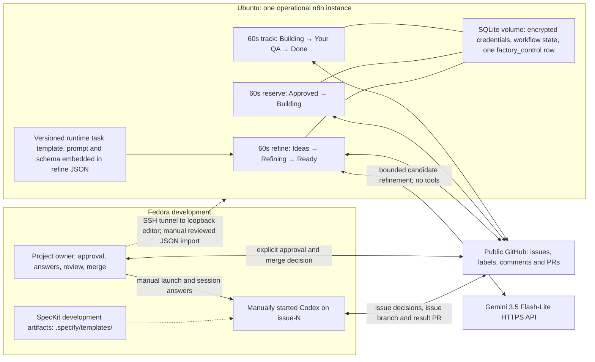
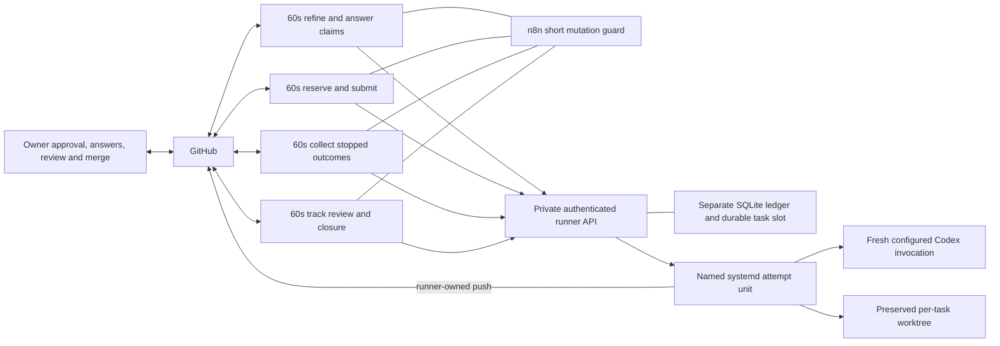

# Basic A architecture

Basic A is three scheduled n8n workflows on Ubuntu, connected through GitHub to an owner
who manually starts Codex on Fedora. There is no runner or automatic agent launch.

GitHub holds durable task state and human decisions. Refine accepts only owner-authored open
issues, captures the exact source, renders candidate advice and never approves it. Reserve
validates explicit owner approval and reserves the single Building slot before manual launch.
Track accepts an unambiguous current-attempt result, preserves rework approval and leaves
closed-unmerged/open-issue work in Your QA. Verified merge or issue closure completes it.
The owner alone grants approval and decides review/merge; the agent asks result-changing
questions in its session and summarizes decisions on the issue.

One serialized production execution and one shared fail-stop control row bound mutations across
all three workflows. Busy is not a task ledger or distributed lock. Acknowledged success/no-work
releases it; failure or uncertain writes retain it. Building survives busy release and laptop
downtime. Owner recovery pauses/drains, reconciles effects, records decisions, repairs known
state and only then resets busy. There is no automatic expiry, failed-execution replay or
concurrent manual mutator.

SpecKit's `.specify/templates/` creates development specifications/plans/tasks. Runtime refine
instead embeds `factory/templates/task.md`, `factory/prompts/refinement.md` and
`factory/templates/refinement.schema.json` through `factory/scripts/build-refine.cjs`.
Compose mounts no development template resolver, host checkout or Docker socket. Optional
Ollama service/cache is retained solely for historical `local-model-trials`; Gemini refinement
does not depend on it. No Redis, worker queue, custom backend, Basic B or advanced extension
is part of this architecture.

The operational editor is server-loopback 5678, accessible through SSH and owner login. The
single-repository GitHub credential allows Issues write and Pull requests read; Gemini receives
only bounded public task data plus the reviewed prompt/template/schema. Saved credentials are
encrypted in n8n and never exported as values. [Permissions](permissions.md) defines the exact
component and data-transfer boundaries.

The existing isolated n8n instance uses a different volume/control table and loopback port 5679.
Credential-free synthetic HTTP fixtures stay on container loopback. Test imports/executions
may be automated after boundary verification; test resources never become operational workflows
or process ordinary tasks. Operational adoption remains owner PR review and manual import of
the matching JSON revision. [Operations](operations.md) covers mapping, stopped-volume backup,
restore, retention and recovery. [Evidence index](../evidence/index.md) separates real tasks
from native fixtures and lists actual outcomes and remaining checks.

## Basic B implementation and adoption boundary

The separate Basic B implementation adds a private Ubuntu Python runner and a fourth scheduled
workflow, collect. These artifacts are inactive preparation; the Basic A diagram above records
the historical manual system, not an adopted Basic B deployment.

The n8n guard serializes mutations and fails closed; releasing it does not release the runner
slot. Reserve records immutable approved input before Building and asynchronous submission.
Collect journals external effects, reconciles exact pushed SHA/PR/result markers, confirms the
issue state and releases only with stopped process and effect proof. Track observes merge or
closure; Done alone never proves execution stopped. Owner answers derive authorization only
from prior explicit approval, exact question/answer and unchanged captured source.

Markers v1 retain Basic A history. Markers v2 bind repository, issue, attempt, initial approval,
specification and result to authenticated runner state. An owner-owned automation credential is
not human approval. Agent checks are attributed reports; Basic B does not independently rerun
them. Only the owner merges. No merge endpoint, automated operational import or advanced review
feedback loop is provided. See [review](review.md) for explicit manual QA rework and
[operations](operations.md) for adoption gates. Existing Basic A evidence remains historical;
local Basic B fixtures do not add genuine task runs.
