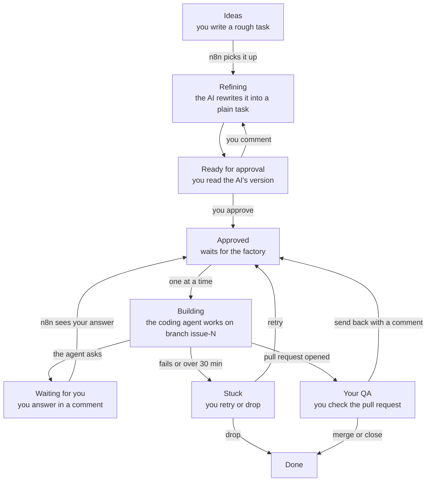
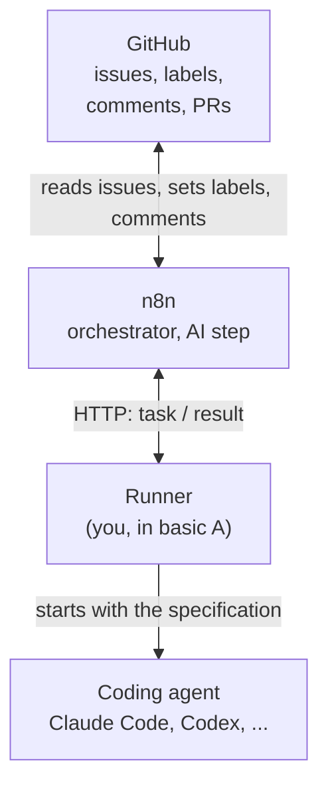

# Final project

> **Note**
>
> Version 2, 25 November 2026. New: the advanced part, a chess game as an example case, and diagrams of what happens in basic A, basic B and advanced. [Version 1](https://vogelsang.github.io/AI-Agenter-E2026-public/projects/factory-project-v1.html) from 18 November is deprecated.

In the final project you will design, build and evaluate your own small software factory: a system where you write a specification, a coding agent builds it, and you stay in control of what gets accepted.

The purpose of the project is to apply the concepts from the course in a realistic way of working. You are not expected to build a coding agent. You are expected to build the system around one: the workflow that picks up tasks, starts the agent, handles its questions and hands its work back to you for review.

The factory’s input is a task: a short specification of what to build. The project should result in a working factory. It should not just be a diagram or a demo of a single run. You must run real tasks through it and show what worked and what did not.

## Project type

This is an individual project. You can help each other, but you have to turn in your own project. Projects that are too similar may be a problem at the exam, so make your factory your own.

## Scope

You must build a prototype of a software factory that works on a code repository.

You use one repository. It holds the factory itself (your n8n workflows and your runner) and, in its own folder, something the factory builds for you, for example a small chess game. All tasks are issues in this repository, so n8n only has to watch one place.

It is recommended that you also build the factory with the factory. Start by building it with your coding agent in the usual way, for example Claude Code or Codex in VS Code. As parts of the factory start working, let the factory take over its own tasks, e.g. when you start extending or fixing the factory. Keep your n8n workflows as JSON files in the repository: the agent changes the JSON in a pull request, and you import it into n8n by hand after your review. That manual step is part of your quality check.

Use the coding agent you already have access to (for example Claude Code or Codex CLI). No particular provider is required. You may also run the coding agent on a local model through Ollama, but it might be hard to do. Claude Code and Codex can both use an Ollama model, so the command stays the same.

### Example: a chess game

If you do not have a case of your own, let your factory build a chess game. These are rough ideas, written the way you would put them in `Ideas`:

1. Make the chessboard: show the board and the pieces, for two players on one machine
2. Rules for the basic moves: legal moves for each piece, check, checkmate and stalemate
3. Rules for the special moves: castling, en passant and promotion
4. Choose a style or colour for the board
5. Save a game and load it again
6. Timing on games
7. Computer opponent: easy
8. Computer opponent: medium
9. Computer opponent: hard
10. Statistics
11. ELO or another chess rating

Some tasks need others first: the opponents need the rules, and the rating needs the statistics. Write that in the issue. What “easy”, “medium” and “hard” mean is up to you. If you choose your own case, keep it about this size.

## How the factory works

Each task is an issue, and its label is its state. This is how a task moves through the factory:

Orange: you act. Purple: the AI works. Pink: n8n moves the task on.

In words:

1. **Ideas** — you write a rough task as an issue with the label `Ideas`.
2. **Refining** — your AI step in n8n rewrites it into a plain task and asks you questions in a comment.
3. **Ready for approval** — you read the AI’s version. Comment to discuss it, and it goes back to `Refining`. When you are happy, you move it to `Approved`.
4. **Approved** — the task waits until the factory has room. One task is built at a time.
5. **Building** — the coding agent works on the task in its own branch, `issue-N`.
6. **Waiting for you** — the agent has a question instead of guessing. You answer in a comment. n8n sees your answer and moves the task back to `Approved`.
7. **Stuck** — the agent failed or ran for more than 30 minutes. Move the task to `Approved` to retry, or close it to drop it.
8. **Your QA** — the work is a pull request with a summary of what the agent did. You check it: merge it, close it, or send it back to `Approved` with a comment. Tests help here: ask the agent to write and run them. Otherwise, try the result yourself before you merge.
9. **Done** — the pull request is merged or the issue is closed.

### Specification template

Your rough task in `Ideas` can be short. Your AI step rewrites it into a plain task that follows a fixed template, so the coding agent always gets the same information. For example: what to build, why, constraints, and acceptance criteria that can be checked. The template is part of your AI step’s prompt. You design it yourself and explain your choices in the report.

### States

The states are labels on the issue. Who sets each one:

| Label | Set by | Basic A | Basic B |
| --- | --- | --- | --- |
| `Ideas` | you |  |  |
| `Refining` | n8n | your AI step runs | same |
| `Ready for approval` | n8n |  |  |
| `Approved` | **only you** |  |  |
| `Building` | n8n | you start the coding agent by hand | the runner starts the coding agent |
| `Waiting for you` | n8n | not used: you answer the agent in its session | the question is posted on the issue |
| `Stuck` | n8n | not used | the agent failed or ran over 30 minutes |
| `Your QA` | n8n, when it sees the pull request | you or the agent open the pull request | the factory opens the pull request |
| `Done` | n8n, when the pull request is merged or the issue closed |  |  |

Only you move a task to `Approved`. The AI advises, it never approves.

Labels are the simple choice. A GitHub Project board with a Status field looks nicer, but n8n’s GitHub node cannot change it, so you would need GraphQL calls through an HTTP node.

## Basic and advanced

The project has two steps: basic and advanced. Basic has two parts, A and B. Build basic A first, then basic B. Advanced builds on basic.

### Basic A: manual factory

- the task board is GitHub Issues or a similar issue tracker, with labels as the task states
- an n8n workflow asks the task board for new tasks on a schedule and sets the state of each task
- one AI step in n8n with a prompt you have written yourself: a refinement of the task. The AI rewrites the rough task into a plain task, asks you questions, and moves it from `Refining` to `Ready for approval`. It gives advice as a comment. You still decide. It can run on a local Ollama model
- you start the coding agent by hand, with the issue as its input. It works in its own branch
- the agent asks instead of guessing. You answer its questions yourself, in the agent’s session
- the result is a pull request with a summary, and test results if the agent wrote tests
- nothing is merged into `main` without your review

What goes where, and when, in basic A:

### Basic B: automated factory

- the factory marks an `Approved` task as `Building` and starts the coding agent itself, through a runner: a small program or container that runs the agent without you. You build the runner yourself, from the architecture below
- one task at a time, and only tasks written by you
- the agent’s questions are posted on the issue, and the task moves to `Waiting for you`. When you answer in a comment, n8n moves the task back to `Approved`, and the agent starts again with your answer
- the factory opens the pull request
- a task moves to `Stuck` if the agent fails or runs for more than 30 minutes

What goes where, and when, in basic B. Refining works as in basic A. The new part is the runner:

### Advanced: safe and extended

Advanced builds on basic B. Do the first two parts, then choose the extensions you like.

**Check the agent’s work.** Do not trust the agent when it says it is done. When the agent stops, the runner checks for itself: is there a change in the code, and do the tests pass when the runner runs them? If not, the task goes to `Stuck`. The real test result goes into the pull request. If the pull request changes existing tests or `.github/`, the factory adds the label `Flagged` and a warning: the agent may have made the tests pass by changing the tests.

**A safe agent.** In basic B the agent runs on your machine with your rights. It can read your files, your SSH keys and your GitHub token, and it can reach the internet. In advanced, the agent runs in its own container on a closed Docker network, where it can reach the model and nothing else. Only the runner holds the GitHub token and pushes the branch.

**Extensions**

- **Memory in Neo4j.** n8n does the work: it reads from and writes to Neo4j. Store each finished task, the files it changed, the questions that were asked, and why a task was rejected. Use vector search to find similar tasks, and the graph to follow the links between tasks and files. Your AI step uses the memory when it refines a new task.
- **An MCP tool for the agent.** An MCP Server Trigger in n8n with a tool such as `search_past_tasks`, which searches the memory. Give the coding agent the tool, so it can look up earlier tasks while it builds. Protect the MCP server with authentication.
- **An AI review.** A second AI step in n8n that reviews each new pull request against the task’s acceptance criteria and posts the review as a comment. Use a different model from the coding agent if you can. It advises, and you still decide.
- **Review comments back to the agent.** When you send a task back from `Your QA`, the agent gets your comments and continues on the same branch.
- **Metrics.** Count what your factory does: tasks done on the first run, questions, stuck tasks, and time per task. Use the numbers in your evaluation.

**Going further** (not expected): choose a model per task, keep track of token use per subscription, or run several agents at once.

What goes where, and when, in advanced, with all the extensions. The new parts are the memory, the container, the runner’s own checks and the AI review:

## Architecture

The factory has four parts:

- **GitHub** (or a similar service) holds everything the factory knows. An issue is a specification, its label is the state, the comments are questions and answers, and the pull request is the result.
- **n8n** is the orchestrator. It asks GitHub for changes on a schedule, runs your AI step, changes labels, writes comments and opens pull requests.
- **The runner** (basic B) is a small program, for example in Python, that n8n calls over HTTP. It does only what n8n cannot do: it checks out the repository on a new branch, starts the coding agent with the specification as its prompt, pushes the branch, and reports back: done, question or stuck. It starts the agent as a command-line call, for example `claude -p "…"` or `codex exec "…"`. It stops the agent after 30 minutes. A run can take many minutes, so the runner answers n8n at once and works in the background, and n8n asks for finished results on a schedule. In basic A you do this part yourself.
- **The coding agent** does the work. Tell it to end every run by stating whether it is done, has a question or is stuck.

### n8n workflows

Basic A has three n8n workflows: refine the task (`Ideas` to `Ready for approval`; it also watches for your comments and moves the task back to `Refining`, or, in basic B, from `Waiting for you` to `Approved`), start a task (`Approved` to `Building`), and track pull requests (`Your QA` and `Done`). Basic B adds one more: collect the results from the runner. Name your branches after the issue, for example `issue-12`, so a workflow can link a pull request to its task.

Two practical points. Let n8n ask GitHub for changes on a schedule: GitHub cannot call n8n on your laptop. And when n8n runs in Docker, it reaches a program on your own machine at `host.docker.internal`, not `localhost`.

## Suggested process

You should work through the project in roughly this order:

1. Create your repository and the labels for the task states.
2. Design the factory: states, workflow, your AI step and permissions.
3. Build basic A with your coding agent. Tip: let the coding agent build and test your n8n workflows through an n8n MCP server (see week 8).
4. Run your first tasks through the factory. If you build the factory with the factory, the next parts of the factory are good first tasks.
5. Automate: build the runner and let n8n start the agent (basic B).
6. Make the factory safer and extend it (advanced).
7. Run tasks that are not about the factory, for example a small chess game.
8. Evaluate the factory: where it worked, where it stopped, and where you had to step in.
9. Document the project.

## Project plan

The project starts on 18 November and is handed in in mid-December. The exact hand-in date will be announced.

1. Week 1: design the architecture and build basic A
2. Week 2: run tasks through the factory and build basic B
3. Week 3: advanced, and tasks that are not about the factory
4. Week 4: evaluate, write the report and hand in the project

## Lectures

The lectures during the project period are planned as follows:

1. 18 November: start of project, walkthrough of project, architecture design. Set up your repository and start the n8n orchestration
2. 25 November: guest session with Andreas Elmertoft, then the advanced part of the project and project work
3. 2 December: supervision
4. 9 and 16 December: online supervision

## Deliverables

You must submit:

- a working factory, including your n8n workflows and your runner
- an architecture diagram
- your specification template
- the prompt for your AI step in n8n
- at least 5 tasks that you have run through the factory, with their issues and pull requests
- a report of max 5 pages

The project is handed in through WISEflow: your report and a link to your repository. The repository must be public, so the examiners can read it. Zip files are not accepted. You must turn in your own project.

## Report

The report must include:

- your architecture and the choice of coding agent and model — including a reflection on capabilities, cost and limits
- your specification template and an explanation of your design choices
- the prompt for your AI step in n8n, an explanation of your design choices, and an example of its output
- implementation overview
- an evaluation of the factory: where it worked, where it stopped, and where you had to step in
- your permission and safety choices: what the agent may and may not do without you
- reflection and future work

Maximum length: 5 pages.

A suggested structure is:

- 1 page on architecture and choice of coding agent
- 1 page on your specification template and your AI step
- 1 page on implementation
- 1.5 pages on evaluation of the factory
- 0.5 page of reflection and future work

## Evaluation

The project will be evaluated based on:

- quality of the architecture and its justification
- meaningful use of n8n
- quality of your AI step in n8n and its prompt
- a working loop, from task to reviewed pull request
- quality of the evaluation of your factory
- how far you got (basic or advanced) and how well it works
- quality of the demonstrated factory in the oral exam
- reflection on limitations and security
- overall quality of the prototype and report

## Oral exam

The project will be evaluated in the oral exam.

At the oral exam you must present and demonstrate your factory. Here you should show your architecture, your n8n workflows, your AI step and its prompt, a task moving through the factory, and how you stay in control of what the agent does.
