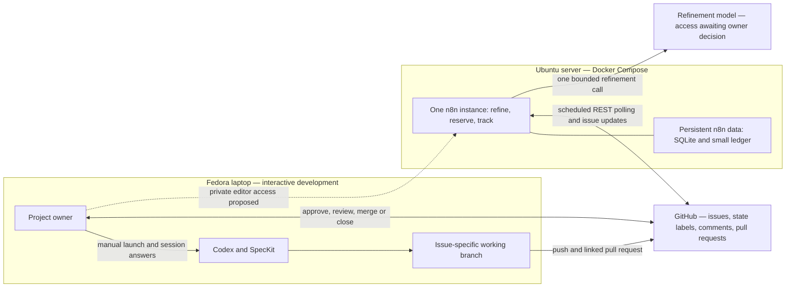

# Implementation Plan: Basic A — Manual Software Factory

**Branch**: `main` (actual Git branch) | **Date**: 2026-11-22 | **Spec**: [spec.md](spec.md)

**Input**: Approved Basic A specification from `specs/001-basic-a-factory/spec.md`.

**Status**: Phase 0 draft; model access and editor access await owner input. Phase 1 is gated.
No implementation, installation, deployment, imports, or GitHub mutations have been performed.
The setup script reports logical feature branch `001-basic-a-factory`; `git branch --show-current`
reports `main`. Feature discovery uses `.specify/feature.json`, not a newly created branch.

## Summary

Keep the Basic A factory small: three scheduled n8n workflows on the Ubuntu server, interactive
Codex development on Fedora, and GitHub issues/comments/pull requests as the shared interface.
Use Docker Compose as requested. No network connection from n8n into the laptop is needed;
the owner reads the reserved issue and manually launches Codex locally.

### Established inputs versus recommendations

| Source | Established requirement or preference |
|---|---|
| Brief; constitution I–III; FR-001–012 | Three scheduled workflows; refinement in n8n; explicit owner approval; manual agent start; issue branch and linked PR; owner review; reviewed JSON imported manually |
| Owner clarification; FR-002 | Accept only issues authored by the project owner in Basic A |
| Owner clarification; FR-006 | n8n sets `Building` to reserve the one build slot before manual launch; it does not prove the agent started |
| Owner clarification; FR-011 | Unmerged PR closure with an open issue leaves `Your QA`; owner returns to `Approved` or closes issue |
| Constitution IV–V; FR-013–014 | Public single repository; separate product folder; limited permissions; no secrets; truthful real-run evidence |
| User preferences; FR-015 and planning request | Codex and SpecKit on Fedora, always-on factory on Ubuntu, Docker Compose preferred |
| Recommendations in this plan | One n8n instance, SQLite, Data Tables ledger, private editor, serial production executions, 60-second polling, deterministic queue order and comment markers |

FR-016 and the spec's P-labelled acceptance targets remain proposed guidance. This plan recommends
adopting them because they test duplicate processing, safe recovery, and a usable manual loop.
The owner has not separately accepted them; include them explicitly in plan review rather than
silently reclassifying them as assignment mandates.

### Repository inspection

- Existing tracked content is the brief, constitution, SpecKit/Codex scaffolding, and ignore rules;
  the new feature spec/checklist are still untracked. No application, deployment, workflow JSON,
  existing runtime database, or server configuration was found locally.
- Origin is `https://github.com/MBroholm/software-factory.git`. Anonymous GitHub REST reads on
  2026-11-22 confirm a public repository with `main` as default and owner ID `202449424`.
- Remote labels were read successfully: `Ideas`, `Refining`, `Ready for approval`, `Approved`,
  `Building`, `Waiting for you`, `Stuck`, `Your QA`, and `Done` all exist. Reuse them; do not create
  or rename labels. Preserve unrelated labels such as `bug` and `documentation`.
- `gh` is installed but unauthenticated. Anonymous reads verified repository facts, not write
  permissions. Ubuntu resources, Docker installation, SSH access, existing services, and model
  credentials have not been inspected. No applicable AGENTS.md or extension hooks were found.

### Recommended architecture



GitHub is the durable human-facing record; the n8n ledger stores processing cursors and recoverable
operations, not a second task board. Refinement uses a basic model call with validated structured
output, not a tool-using agent. The model cannot change labels, execute code, approve, or merge.
The fixed task template is distinct from SpecKit's feature specification template; using SpecKit
for development does not require every factory-built task to run the full SpecKit workflow.

## Technical Context

**Language/Version**: n8n workflow JSON plus small JavaScript transforms supported by the pinned
n8n release; Bash/Git/GitHub CLI for owner runbooks. No custom application runtime or service.

**Primary Dependencies**: Docker Engine and Compose plugin on Ubuntu; a supported n8n release
with Schedule Trigger, HTTP Request, Data Table, and basic structured LLM output support. Pin the
exact tested image version/digest during implementation; record it in release evidence rather
than inventing an untested version now. GitHub REST API; Git and interactive Codex on Fedora.

**Storage**: Recommend default SQLite in a named volume at `/home/node/.n8n`, with small n8n Data
Tables for task cursors, reservations, and operations. Back up the stopped service's volume and
encryption key together. No PostgreSQL, Redis, distributed workers, or product database yet.

**Testing**: Table-driven transition/guard tests; workflow JSON and secret checks; mock GitHub
and deterministic model responses in an isolated instance; one real task including refinement
revision, session question, issue summary, linked PR, and owner decision; targeted interruption,
rework, unmerged-close, and queue tests. See acceptance map below. No tests have run yet.

**Target Platform**: Ubuntu server for n8n; Fedora laptop for manual agent execution. Exact OS
versions, server resources and Docker availability are deployment preflight checks, not assumed.

**Project Type**: Workflow automation with operating instructions and a separate product folder.

**Performance Goals**: Recommend 60-second polling for each workflow, one issue per refinement
execution and at most one model request per issue revision. State changes appear on the next
successful eligible check, allowing queueing or external-service failure; no hard latency SLA.
Use a 60-second model request timeout and no automatic model retry after an ambiguous failure.
These are recommendations, not course requirements or the deferred Basic B 30-minute timeout.

**Constraints**: Single factory instance; serial scheduled mutators; manual Codex start; only
owner-authored issues; explicit approval per scope; no secret exports or autonomous import/merge.
No production-mutating editor tests while schedules are active. One build reservation persists
across workflow executions and restarts until reconciliation confirms release.

**Scale/Scope**: One owner, one repository, three workflows, one manual build at a time. Basic A
validation first; the project's five-run evaluation and runner remain later obligations.

**NEEDS CLARIFICATION — D1**: Refinement model access, provider/model and owner-approved spend
boundary. Recommend a hosted API for predictable setup unless a usable local model already
exists. No provider, paid account, key, local hardware, or subscription-to-API equivalence is assumed.

**NEEDS CLARIFICATION — D2**: Private editor access. Recommend loopback-only server binding and
SSH forwarding. Confirm whether SSH, an existing VPN, or public HTTPS is appropriate before
finalizing Compose/network and quickstart contracts.

### Workflow behavior recommendations

1. **Refine**: Poll eligible open owner-authored issues; exclude PR records. For `Ideas`, or a
   new owner discussion comment at `Ready for approval`, record an input revision, enter
   `Refining`, make one bounded model call, validate template fields, post a marked refinement
   comment, then set `Ready for approval`. Store comment/event IDs; marked factory comments
   never trigger refinement, even if the credential shares the owner's identity. Preserve
   prior refinements and questions. Failed/ambiguous operations remain visible for owner recovery.
2. **Reserve**: Poll `Approved`, oldest valid approval event first, issue number as tie-breaker.
   Require author owner ID, a current successful refinement, and an owner-authored `Approved`
   label event after that refinement. Snapshot the refinement comment content and issue body.
   Reject a changed snapshot or missing actor/event provenance rather than guessing approval.
   Read all `Building` issues and the ledger; only claim a free, consistent slot. Write a
   pending reservation before GitHub updates; reconcile partial writes before choosing another
   issue. Set `Building`, remove only the prior factory state label, and post a stable handoff
   comment. The owner starts Codex locally on `issue-N` from the current `main` and approved
   snapshot, then posts material session decisions back to the issue.
3. **Track**: Reconcile closed task issues and PRs explicitly linked to each current build
   attempt. Require same-repository `issue-N` head, `main` base, and an explicit issue reference;
   ambiguous/multiple active results stop that task's progression. Record attempt/PR association
   to avoid old PRs undoing owner-requested rework. Detect a new/reopened PR or new head work after
   the latest approval, not merely an old PR sharing the branch. A current result enters
   `Your QA`; merged result or closed issue enters `Done`; closed-unmerged result with open issue
   remains `Your QA`. A later explicit owner return to `Approved` wins over stale QA observations.

Production serialization (`N8N_CONCURRENCY_PRODUCTION_LIMIT=1`) is a single-instance execution
constraint, not a GitHub lock. Every workflow must read its preconditions again immediately
before mutation; owner label changes still race REST writes. Inspect actor/timeline changes
before committing transitions; on detected concurrent edits, reconcile and stop that operation.
There is no claim of atomic transactions across GitHub and n8n. Persist pending operations and
look for deterministic factory-comment markers before retrying writes with unknown outcomes.

Approval provenance can be checked through GitHub timeline actors, refinement IDs and content
snapshots. Revalidate before handoff. The owner must also compare the snapshot when launching
Codex; labels alone cannot stop someone manually running an agent on unapproved inputs. For
scope changes during a session, stop, summarize the proposed change, obtain renewed explicit
owner approval, and update the snapshot before continuing. No automated scope judgement by an LLM.

### Permissions and human actions

| Component | Recommended minimum | Explicit boundary |
|---|---|---|
| n8n GitHub credential | Fine-grained token scoped to this repository: Issues write, Pull requests read, required Metadata read | No Contents write, PR write, Actions administration or merge authority; code never sets `Approved` |
| Refinement step | Model inference credential only | No tools, host access, repository credentials or state-changing decisions |
| Laptop agent | Issue reading; working-tree edits and owner-authorized branch push/PR creation | No autonomous task approval, main merge, production n8n access, or workflow activation |
| Project owner | Approvals, review, merge/closure, retry decisions, server administration | Manually imports reviewed workflow JSON and confirms active revision |

A GitHub token's Issues write permission is coarser than individual label permissions. A token
owned by the project owner also shares their actor identity. Software guards and owner-only
manual operation constrain it; GitHub does not enforce a separate prohibition on setting
`Approved`. A dedicated automation identity improves attribution but is optional extra setup,
not silently required for Basic A. Never infer owner comments solely from matching author login:
exclude known factory comment IDs/markers. Store credentials in n8n's credential store; keep the
encryption key and server environment outside Git, with restricted file permissions. Do not
mount the Docker socket, host Git checkout, or laptop credentials into n8n.

### Proportionate delivery sequence and validation

| Increment | Deliverable | Acceptance focus |
|---|---|---|
| 1 | Compose/environment example, private access, persistence and backup runbook | Restart retains credentials/configuration; no public editor or secrets in exports |
| 2 | Fixed task template, prompt, example, refine JSON | FR-001–005; revision and question history; owner-only intake; invalid output/outage stays unapproved |
| 3 | Reserve JSON and manual launch/recovery guide | FR-006–008; one slot across polls/restart; second task waits; Codex never auto-starts |
| 4 | Track JSON, branch/PR/decision/evidence conventions | FR-009–013; merge, issue-close, closed-unmerged, rework and stale PR handling |
| 5 | Real-run evidence, architecture and permissions docs | FR-014–016; SC-001–006 proposed checks; honest failures and manual intervention |

For each workflow, generate and review JSON in Git before the owner manually imports it into
an isolated test instance, then production. Do not activate via automatic deployment. Use small
fixtures for non-owner issues, bot comments, pagination, malformed states, ambiguous timed-out
comment POSTs, approval snapshot edits, and stale PRs. Interrupt before/after each multi-system
write and prove reconciliation does not claim another slot or duplicate a completed refinement.
Test manual UI executions only with all mutating schedules paused and in-flight work drained.
Do not turn this prototype into a custom workflow engine or a comprehensive test platform.

Manual recovery: pause schedules, inspect the issue and operation/reservation rows, confirm no
agent is still running, summarize the failure publicly without secrets, reconcile partial writes,
and have the owner explicitly return eligible work to `Approved` or close it. Do not release a
reservation merely due to elapsed time or borrow Basic B's `Stuck` label.

## Constitution Check

*GATE: Must pass before Phase 0 research. Re-check after Phase 1 design.*

| Gate | Pre-research assessment | Required post-design evidence |
|---|---|---|
| I: human approval/review | PASS: no auto-approve, merge or workflow import proposed | Transition/approval and import contracts; manual runbook |
| II: issue traceability | PASS: issues, immutable revision references, linked result, session summaries | Entity model, task/PR contracts and evidence guide |
| III: stages/bootstrap | PASS: interactive bootstrap; Basic A only; no runner | Manual handoff/recovery scenarios; real-run validation before Basic B |
| IV: bounded/public work | PASS: repository verified public; component permissions specified | Private access confirmation; credential/export checks |
| V: truthful evidence | PASS: checks reported as planned, never as passed | Acceptance guide with actual outcomes filled during implementation |
| Planning/review gates | PASS in draft: stage, acceptance checks, permissions and owner actions identified | Phase 1 consistency review after D1/D2 resolved |
| Instructor confirmation | Preserved follow-up: unconfirmed interpretation; automated resumption excluded | Do not claim instructor confirmation; amend constitution if contradicted |

**Gate result**: No identified constitutional violation. Phase 0 cannot be finalized while D1
and D2 remain unresolved. Post-design gate is NOT YET RUN; Phase 1 is intentionally not generated.
The skill requires stopping on unresolved clarifications; this is a reviewable draft, not an
implementation-ready plan.

## Project Structure

### Documentation (this feature)

```text
specs/001-basic-a-factory/
├── spec.md
├── checklists/requirements.md
├── plan.md                 # this draft
├── research.md             # researched decisions and remaining questions
├── data-model.md           # Phase 1, after D1/D2 resolution
├── contracts/              # Phase 1: task lifecycle, model output, manual handoff
└── quickstart.md            # Phase 1: runnable validation guide
```

`tasks.md` is deliberately not created by the plan command. Proposed Phase 1 artifacts listed
above are not yet present. The existing spec and its quality checklist remain unchanged.

### Source Code (repository root)

Proposed layout for implementation, not files created by this planning turn:

```text
factory/
├── compose.yaml
├── .env.example
├── workflows/{refine,reserve,track}.json
├── prompts/refinement.md
├── templates/task.md
└── tests/fixtures/
docs/
├── architecture.md
├── operations.md
└── permissions.md
evidence/                    # sanitized real-run links/outcomes
product/                     # separate software built by the factory; choice deferred
```

**Structure Decision**: Group the three workflows and deployment artifacts under `factory/`;
keep the future built software separate under `product/`. Names are recommendations, not source
mandates. No web app, custom server, shared package, or future runner stub is introduced.

## Complexity Tracking

No constitutional exceptions requested. SQLite and built-in Data Tables are a small-instance
tradeoff; production serialization and crash reconciliation still need tests. If reconciliation
cannot meet FR-016 within this design, revisit it before implementing another service.

Basic B compatibility comes from the approved issue snapshot, one reservation, issue branch,
linked PR and explicit outcomes. Later the reserve workflow can invoke a runner after reserving
the slot. Do not build an HTTP runner API, queue infrastructure, remote shell execution, or
agent container now. Basic B will require its own specification, evidence gate, and permissions
review; its introduction is not a promise that this design scales to multiple workers unchanged.
