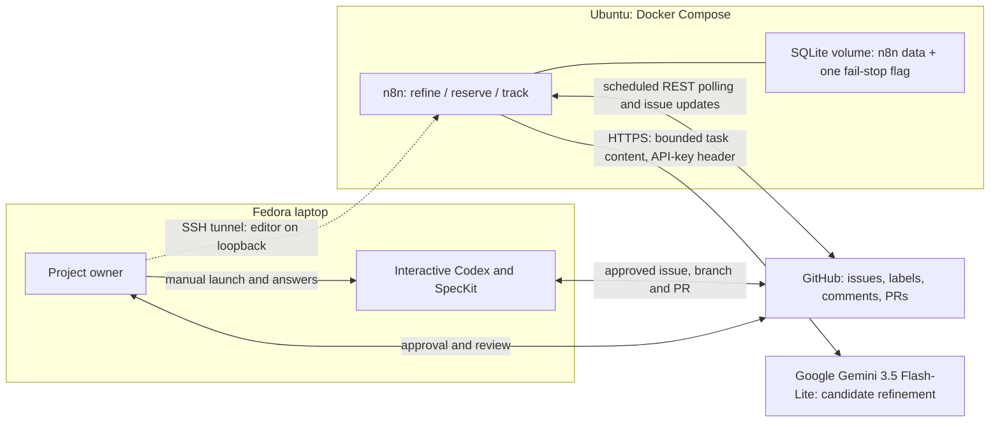

# Implementation Plan: Basic A — Manual Software Factory

**Branch**: `001-basic-a-factory` | **Date**: 2026-11-24 | **Spec**: [spec.md](spec.md)

**Input**: Approved Basic A specification; constitution v2.0.0; project-brief.md version 2 (2026-11-25); owner's complexity review,
Fedora/Ubuntu/Compose preferences, SSH availability, completed model trials and explicit owner
decision on 2026-11-24 to adopt Gemini 3.5 Flash-Lite refinement on the free tier.

**Status (2026-11-26)**: T001–T019 and scheduled-path T031/T032 are complete, with the
recorded limits in their evidence. US3 tracking (T020 onward) and final Basic A acceptance remain
incomplete. T033 verifies existing isolated-test boundaries before future automated imports or
native isolated tests. This governance alignment changes no workflow or deployment, resets no
tasks and does not claim new checks. Historical planning observations below retain their dates.

## Summary

Use three scheduled n8n workflows on Ubuntu and manually launched Codex on Fedora. GitHub issues,
labels, comments and pull requests connect them. Deploy n8n with Docker Compose; use the Gemini
3.5 Flash-Lite HTTPS API for refinement. The existing Ollama service/cache are trial artifacts,
not a runtime dependency; make its startup optional during T012 without deleting its data.
The owner accesses n8n's editor through SSH forwarding; no public editor or webhook is needed.
Keep human approval, questions in the agent session, review and manual operational workflow JSON import.

### Requirements, preferences and recommendations

| Classification | Inputs |
|---|---|
| Brief/constitution; FR-001–014 | Three workflows; fixed refinement template; explicit approval; manual coding-agent launch; one build at a time; branch/PR linkage; human review; manual operational JSON import; bounded permissions and truthful evidence |
| Confirmed owner policies; FR-002, 006, 011 | Only owner-authored issues; `Building` reserves the slot before manual launch; unmerged PR closure leaves `Your QA` while issue remains open |
| Owner preferences; FR-015 | Interactive Codex/SpecKit on Fedora, always-on Ubuntu factory, Docker Compose; SSH access is available |
| Owner-selected design, 2026-11-24 | Gemini 3.5 Flash-Lite refinement using the confirmed free-tier project; no automatic paid/model fallback |
| Design recommendations | SQLite; one serialized n8n instance; one shared fail-stop flag; GitHub comment markers; direct Gemini HTTP Request node; SSH forwarding; 60-second polling |
| Spec proposals, not brief mandates | FR-016 reliability behavior and P-labelled success targets; this plan retains them as design/validation targets without calling them assignment mandates |

The spec is aligned with constitution v2.0.0; the constitution is unchanged by this alignment. The layout, polling interval, flag, marker format and
model candidate are recommendations, not requirements discovered in the brief.

### Development templates versus runtime refinement

SpecKit templates under `.specify/templates/` guide development artifacts such as specifications,
plans and implementation tasks. They are not read as factory runtime task templates. Factory
refinement uses its own versioned `factory/templates/task.md` and
`factory/prompts/refinement.md`, maintained together with the refine workflow JSON. During manual
import, the owner verifies the deployed workflow contains the reviewed template/prompt versions;
Compose does not mount the development template tree as runtime refinement configuration.
Changes to runtime template/prompt content are reviewed with affected workflow JSON for
operational adoption and manually imported by the owner; isolated test imports may be automated. No general template
resolver or full SpecKit pipeline is added
to the running factory.

### Inspection and preservation

At initial planning, the repository had the brief, constitution and SpecKit scaffolding, with no
application, workflow JSON or deployment. The original uncommitted feature files were committed
on `001-basic-a-factory` before editing; `main` was not changed. Feature discovery uses the local,
ignored `.specify/feature.json`. Anonymous GitHub reads on 2026-11-22 confirmed the public
`MBroholm/software-factory` repository, owner ID `202449424`, default `main`, and all nine existing
state labels. Reuse labels and preserve unrelated labels. Subsequently GitHub CLI authentication
was verified and T001–T003 deployed; the 2026-11-24 evidence records actual server checks.
No applicable AGENTS.md or pre/post planning extension hooks were found.

### Architecture



No runner, custom backend, Redis, workers, reverse proxy or PostgreSQL. The Compose network
permits n8n outbound GitHub and Google API access; no new inbound port is needed. Persist n8n
data and preserve the separate existing Ollama cache during the transition. No Docker socket, host checkout,
laptop credentials or command-execution ability is mounted into n8n.

## Technical Context

**Language/Version**: n8n workflow JSON and small JavaScript transforms; Bash/Git/GitHub CLI for
manual runbooks. Pin tested n8n images and record Gemini's requested model ID, returned model
version and prompt/template hashes. The hosted model alias is not an immutable model digest.

**Primary Dependencies**: Docker Engine/Compose on Ubuntu; n8n Schedule Trigger, HTTP Request,
Data Table and transformation nodes; Gemini generateContent HTTPS API with JSON-schema output;
GitHub REST. No SDK, model router, tool-enabled agent node or separate provider service is needed.
Codex remains interactive on Fedora; no change to its login or subscription is proposed.
Python 3 standard-library unittest is the recommended lightweight fixture-test tool on Fedora.

**Storage**: n8n's default SQLite and credential store under persisted `/home/node/.n8n`; one
`factory_control` Data Table with one row, described in [data-model.md](data-model.md). GitHub
holds task state and marked refinement/handoff comments. No per-task DB, event cursor table,
approval journal, reservation table, operation journal or autonomous recovery state machine.

**Testing**: Small contract fixtures for guards/transitions and marker parsing; targeted live
workflow exercises; one real manual run with a session question and PR. Use the acceptance matrix
and commands in [quickstart.md](quickstart.md). Actual model/server observations are in
[Gemini evidence](../../evidence/gemini-evaluation.md). US1/US2 workflow results are recorded in
their validation evidence; US3 and completed-workflow acceptance checks remain pending.

**Target Platform**: Ubuntu server for n8n; Fedora laptop for Codex, Git and SSH tunnel.
Existing Ollama deployment remains unused until made optional. Server preflight and API smoke
access passed; owner confirmed browser login. Saved credential/node checks are revision-specific; consult US1 evidence for completed checks.

**Project Type**: Single-user workflow automation, deployment/runbooks and a separate product folder.

**Performance Goals**: Recommend 60-second schedules and one refinement per execution; reserve
lowest issue number among eligible approvals for deterministic selection. A successful eligible
poll observes a change; no hard service SLA. Gemini request timeout: 120 seconds,
one request at a time, temperature 0, minimal thinking, 768-token output cap and the existing
provider countTokens preflight (4096-token application envelope, not a hosted context setting),
including a fixed schema allowance plus the 768 output / 256 overhead reserves. A separate
32 KiB serialized-request transport cap prevents oversized transfers. Owner approved replacing
the earlier byte-as-token screen on 2026-11-25; see the amended refinement contract.
Owner-approved generation-only HTTP 503 UNAVAILABLE retries wait 10/30 seconds in-process,
with three attempts maximum, identical counted payload and guard/source checks before each.
The serialized slot remains occupied for up to three 120-second provider timeouts plus 40 seconds
of waits and GitHub reads. Other failures/exhaustion hold for manual recovery; no replay or
durable resume. See the amended refinement contract. These are design choices,
not assignment requirements or Basic B's deferred 30-minute runner timeout.

**Constraints**: One production instance; `N8N_CONCURRENCY_PRODUCTION_LIMIT=1`; no manual mutating
runs while schedules are active. A held control flag blocks all three workflows pending manual
inspection; a `Building` label separately occupies the long-lived manual build slot. Single
writer and operator discipline are deployment constraints, not distributed-lock guarantees.

**Scale/Scope**: One repository/owner, three workflows, one coding task building at a time.
Basic B and advanced extensions are deferred; no runner API is designed or implemented here.

### Owner-selected model and resolved editor access

**Owner decision, 2026-11-24**: Adopt `gemini-3.5-flash-lite` using the confirmed free-tier
project, replacing the failed Ollama candidates. The five-case v2 comparison had four clean
semantic passes and one privacy-criterion gap; v3 fixed that gap in a targeted rerun and a
server-container smoke check. The affected ambiguity/revision/conflict cases subsequently passed
v3; injection retains unaffected v2 evidence. Preserve these version distinctions;
do not claim a five-case v3 regression pass. Close any change-affected validation before activation.

The tradeoff is better observed quality and reduced local inference needs in exchange for
internet/provider availability, shared project quotas and sending bounded issue content to
Google. Use a header-auth n8n credential, no key literals in workflow JSON. Owner-reported caps
were 15 RPM / 250,000 input TPM / 500 RPD; verify the active dashboard before activation, since
these are project-specific and may change. The 60-second poll is not permission for 1,440 daily
inferences: only new revisions call the model. A 429 or any uncertain failure holds the flag;
manual recovery checks quota availability before choosing a retry. Add no quota ledger.

Free tier only: do not enable billing, increase spend or switch model/provider automatically.
No model tools or GitHub credentials reach Gemini. See the exact request, permission and
data-transfer boundary in [contracts/refinement.md](contracts/refinement.md) and verified
sources in [research.md](research.md). Private owner-only development is the current scope;
making an API client available to other users requires checking the provider's regional terms.

SSH access answers the editor question: bind n8n's published port to `127.0.0.1:5678` on Ubuntu,
forward it to Fedora with `ssh -N -L 5678:127.0.0.1:5678 user@server`, then visit
`http://localhost:5678`. Keep n8n owner login; the tunnel transports the connection, not the
login. Configure editor URL/cookie behavior for that loopback origin in the pinned release;
verify login through the tunnel before activation. No domain or public HTTPS decision remains.
The actual server alias and hardware/model sizing are deployment parameters, not unresolved
architecture choices. SSH and container/API access were verified on 2026-11-24; browser login
through the tunnel was subsequently confirmed by the owner.

### Complexity review: requirement-to-mechanism decisions

| Previous mechanism | Requirement that needs the behavior | Smallest recommended design / disposition |
|---|---|---|
| Per-task processing/cursor ledger | FR-004 revision comments; FR-016/SC-005 no repeats/self-trigger loops | **Remove.** A marked refinement records source body digest and latest included owner comment ID; poll comments and skip an unchanged source. Low volume makes pagination acceptable. |
| Approval journal and historical content reconstruction | FR-005, FR-008; constitution I explicit approval and renewed scope approval | **Remove journal.** Check the owner actor on the latest `Approved` label event, the latest refinement ID/edited time and its input digest; handoff cites that event/refinement. Owner verifies approved content at launch. No LLM judges scope. |
| Independent reservation table | FR-006/007; one slot survives manual launch delay | **Remove.** All `Building` issues occupy the slot, even unexpected/non-owner issues. Polling serialization plus a held failure flag covers a partial transition; no elapsed-time release. |
| Pending-operation journal with automatic reconciliation | FR-016 and SC-005 interruptions/uncertain writes | **Remove.** Stop safely and use documented owner recovery; no automatic resume from `Refining`, retry of an uncertain POST, or guessed state repair. |
| Durable failure interlock | FR-016: ambiguous failures must not falsely advance/duplicate; SC-003/005 | **Keep one row only.** Set busy before mutating; clear last on success. Crash/error leaves busy; subsequent schedules skip. This flag is an interlock, not the build reservation or a work ledger. |
| Build-attempt ledger and historical PR reconstruction | FR-010/011 rework and closed-unmerged behavior | **Remove.** One marked handoff per approval event records current PR numbers/head SHAs as a baseline; accept only unambiguous later work. Owner resolves ambiguous rework while paused. |
| Automatic recovery of labels/outcomes | FR-016 requires owner-controlled recovery; constitution III/V evidence | **Remove.** Preserve current labels, log error, pause/drain/inspect, record reason and repair manually. No new `Stuck` or `Waiting for you` use. |

Marked comments are normal human-visible task evidence with a few machine-readable identifiers,
not a replayable event store. The one control row is justified because simply ending a failed
execution would allow the next scheduled execution to retry an ambiguous write. It is shared by
the three workflows and relies on production serialization; a Data Table upsert is not claimed
to be an atomic distributed lock.

### Requirements that could drive disproportionate complexity

- FR-016 and edge-case wording do not explicitly require automatic crash recovery or unconditional
  exactly-once delivery. This plan preserves repeat suppression and stops for manual recovery.
  Guaranteeing exactly-once side effects under arbitrary late API responses and concurrent human
  edits would require stronger coordination than GitHub labels provide. That guarantee is **not
  claimed**. If intended, clarify/amend that requirement before implementation; do not quietly
  drop it or add a transaction platform.
- FR-005's explicit approval is mandatory, but a cryptographic approval/signature system or
  complete reconstruction of all edited/deleted comment versions is not. Current digests and
  timestamps plus the owner's manual launch check handle normal scope changes. Ambiguous edits
  require fresh refinement/approval; missing history stops, never infers approval.
- FR-010/011 require correct rework outcomes, not an automatic association of every historical
  branch/PR combination. A simple explicit link and recorded baseline suffice for ordinary runs;
  manual association checks are required if multiple results or unchanged reopened PRs are unclear.
- SC-002 proposes at least one real Basic A run. It does not waive the final project minimum of
  five runs, or the later runner. Use a few focused scenarios, not a new testing framework.

### Workflow design

All workflows enter the shared guard, read GitHub state, apply deterministic rules, then release
the guard only after all side effects are acknowledged. Full behavior is in
[contracts/task-lifecycle.md](contracts/task-lifecycle.md).

1. **Refine**: Accept only owner-authored open issues. New `Ideas`, or new unmarked owner comments
   at `Ready for approval`, select a source revision. Set `Refining` before calling Gemini; post
   validated marked output; set `Ready for approval`. Ignore own marked comments even when the
   token actor is the owner. Never rerun stranded `Refining` automatically.
2. **Reserve**: Check all issues for occupied/conflicting `Building` labels. If free, select an
   eligible `Approved` issue, validate owner approval/current refinement, set `Building`, and post
   handoff evidence. Label persists until PR/issue outcome or owner repair. The owner manually
   launches Codex on `issue-N` and summarizes material session answers on the issue.
3. **Track**: Recognize explicitly linked current-attempt PRs to `main` from `issue-N` in this
   repository. Enter `Your QA`, or `Done` for merged results/closed issues. Unmerged closure with
   an open issue remains QA. Historical PRs cannot override a newer owner rework approval. An
   ambiguous match is visible and held for owner resolution rather than guessed.

Only manage the factory state labels; preserve other labels. GitHub label transitions require
multiple requests, not a transaction. Add the target state before removing the source; the held
control flag makes partial transitions safe to stop, and recovery normalizes them manually.
Re-read approval/labels before writes. During normal operation the owner only makes documented
state transitions; pause/drain before repairing state or editing already approved task content.
There is no claim that REST reads prevent every race with an independent human/API client.

### Deployment, permissions and recovery

Use SQLite for the small single-instance deployment; back up the stopped n8n volume with its
encryption key. Restore workflows, credentials and control row together and inspect the flag
before resuming. Preserve the unused Ollama cache; do not delete volumes as provider cleanup. Retain
private n8n failures for diagnosis, prune payloads (recommend 14 days), and store sanitized real-run
links/outcomes in GitHub and `evidence/` so pruning does not erase course evidence.

| Component | Recommended access | Human boundary |
|---|---|---|
| n8n | Single-repository fine-grained token: Issues write, Pull requests read, required Metadata | Never sets `Approved`, changes code, creates/merges PRs, or adopts operational workflow changes |
| Gemini API | HTTPS input: reviewed prompt/template/schema and bounded public issue/discussion data; dedicated header-auth n8n credential | Candidate JSON only; no tools, approval, GitHub access or automatic paid/model fallback |
| Fedora Codex | Working tree, issue reading and owner-authorized branch push/PR creation | Manual launch and in-session questions; no autonomous approval, main merge or production access |
| Owner | Approval/review, GitHub merge/close, Ubuntu SSH and n8n administration | Manually imports reviewed operational JSON; performs failure recovery |

Issues write is coarser than permission to change individual labels. An owner-owned token has
the same actor ID as the owner; code policy and operational separation enforce the no-approval
rule, not label-specific GitHub authorization. Filter factory comments by markers as well as
actor. A dedicated automation identity/App may improve attribution later but is not required.
Store secrets in n8n credentials/server-local restricted files; exports contain no credential
values, machine data, execution payloads or pinned test data. Never mount the Docker socket.

Manual recovery is deliberately documented rather than automated: pause all three schedules,
drain executions, check whether a laptop agent is still running, inspect GitHub and n8n failures,
record the failure/decision on the issue, repair only the known outcome, obtain fresh approval
for changed scope, then reset the shared flag and resume. Do not retry an uncertain comment POST
until checking for its deterministic marker. If GitHub is unavailable, retain the held flag and
private n8n failure; publish the sanitized issue summary when access returns. See quickstart.

### Delivery increments and acceptance map

| Increment | Deliverable | Acceptance / source |
|---|---|---|
| 1 | Minimal Compose/private access, runtime prompt/template and early model evaluation | FR-003/013/015; failed local trials preserved; owner selected Gemini after comparison/server smoke check; remaining evidence closeout visible |
| 2 | One guard row, explicit guard-path tests, refine workflow and final prompt/example | FR-001–005/016; SC-001/005; successful/no-work release, unexpected-failure retention, owner-only intake and revision dedup |
| 3 | Reserve workflow and manual Codex instructions | FR-006–008; SC-002/003; delayed launch, second task waits, no auto-start |
| 4 | Tracking workflow and manual recovery | FR-009–012/016; SC-004/005; merge, issue closure, closed-unmerged, rework and interrupted transition |
| 5 | Architecture/permissions docs and real-run evidence | FR-014; SC-006; real task with question and PR; honest outcomes |

The early local-model trial preceded full workflow implementation. Its failure led to the
explicit owner-selected Gemini alternative, satisfying the model-choice checkpoint. Complete
remaining change-affected prompt/credential/node checks before activating refinement.
Shared-flag tests must exercise all three actual workflow paths: acknowledged success and
acquired-but-no-work release to idle; unexpected exceptions, crashes, ambiguous writes and failed
cleanup retain busy; a pre-existing busy flag is never cleared by a skipped execution. Use no
unconditional finally/cleanup release. Document manual recovery instead of adding auto-repair.
See [tasks.md](tasks.md) for the ordered implementation and test work; none is executed by this
planning amendment.

Each workflow JSON change is versioned. Isolated automated testing follows the boundary below;
operational adoption, including bootstrap, requires owner PR review and manual import of the
matching reviewed revision, before or after merge. Develop on the feature branch; later factory tasks use issue-specific branches.
Acceptance results come only from linked evidence, not this design. The existing task list is
amended for the owner-selected provider; no workflow implementation is performed here.

## Isolated testing and operational adoption

Constitution v2.0.0 and `project-brief.md` version 2 (2026-11-25) govern this feature.
The coding agent may automatically import, update, and execute workflow JSON only in a
designated isolated development/test n8n instance, using test data and scoped test credentials.
External writes must target designated test resources. Testing must not replace or activate
operational workflows or process ordinary factory tasks. Verify instance identity, separate
storage/control tables, destinations and credential mappings before testing; an unknown
boundary stops the test. Existing `factory-guard-test` fixtures may be reused after T033 verification; this gates future
automated imports/native isolated tests without blocking offline US3 implementation.

Operational adoption requires owner review of versioned JSON in its pull request and owner
manual import of that reviewed revision into operational n8n. Verify that the imported artifact
matches the reviewed artifact; record necessary instance-specific credential/table mappings.
Subsequent changes require renewed review and manual operational import. This may occur before
merge for final acceptance testing or after merge. Manual import does not require manual
execution of every test. Record tested source revision/hash, imported revision, environment,
actual outcomes and test-copy deltas; distinguish fixture results from real factory runs.

Only the owner grants initial task approval. Unchanged-scope work may resume after the owner's
answer; expanded scope requires renewed explicit owner approval. This is accepted project
policy and requires no instructor confirmation. Basic A retains in-session answers and manual
rework/recovery; this policy does not add automated question handling or recovery. Owner review
and merge authority remain unchanged. Completed tasks and valid evidence are preserved; run
only missing or change-affected checks. Basic B and advanced implementation remain out of scope.

## Constitution Check

*GATE: Must pass before Phase 0 research. Re-check after Phase 1 design.*

| Gate | Pre-research | Post-design assessment / artifact |
|---|---|---|
| I human approval/review | PASS | PASS: owner approval event plus current refinement; manual start, review and JSON import in lifecycle/quickstart |
| II traceability | PASS | PASS: data model and handoff contract preserve issue, decisions, branch and PR |
| III incremental/basic scope | PASS | PASS: no runner; documented manual failure recovery; real Basic A validation before Basic B |
| IV permissions/public work | PASS | PASS: public repository verified, private services, component access documented; deployment checks still to run |
| V evidence | PASS | PASS: quickstart records unrun/failed checks honestly; final five-run requirement preserved |
| Review gates | PASS | PASS: acceptance matrix, source distinctions, human actions, workflow and permission review identified |
| Approval/resumption policy | PASS | Accepted owner policy; unchanged-scope continuation allowed, expanded scope reapproved; no instructor confirmation or Basic A automated resumption required |

The isolated-testing permission is constitutional policy, not an exception request. The model choice is resolved by the owner's Gemini
decision; remaining work is US3 tracking and final Basic A validation/evidence, not local sizing.
Do not activate refinement if the benchmark fails. No unresolved scope decision is hidden by a
default, and no implementation readiness is claimed before the operational checks pass.

## Project Structure

### Documentation (this feature)

```text
specs/001-basic-a-factory/
├── spec.md
├── checklists/requirements.md
├── plan.md
├── research.md
├── data-model.md
├── contracts/
│   ├── task-lifecycle.md
│   ├── refinement.md
│   └── manual-handoff.md
├── quickstart.md
└── tasks.md
```

### Source Code (repository root)

Proposed paths for implementation; none are created by this planning turn:

```text
factory/
├── compose.yaml
├── .env.example
├── workflows/{refine,reserve,track}.json
├── prompts/refinement.md
├── templates/task.md
└── tests/fixtures/
docs/{architecture,operations,permissions}.md
evidence/
product/
```

**Structure Decision**: Keep the factory together, the built software separate, and evidence
sanitized. Use SpecKit templates for development artifacts. Factory refinement uses the versioned
task template and prompt under factory/.

## Complexity Tracking

No principle violation or exception. The only new durable application control is one fail-stop
row; GitHub supplies task state/history. Data Tables are already part of n8n and add no service.
The tradeoff is manual repair and occasional conservative halts instead of autonomous recovery.

Basic B can later replace the manual launch after `Building` with a runner call, retaining the
issue contract and review loop. Its runner/timeout/result-collection/authentication work remains
separate and will need validated Basic A evidence and a new plan. No premature runner stub or
transport abstraction is included.
