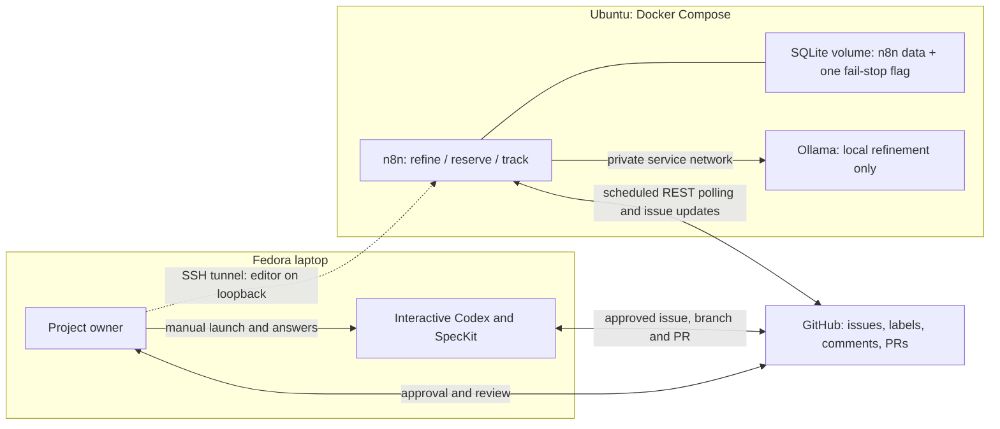

# Implementation Plan: Basic A — Manual Software Factory

**Branch**: `001-basic-a-factory` | **Date**: 2026-11-23 | **Spec**: [spec.md](spec.md)

**Input**: Approved Basic A specification; constitution v1.1.1; owner's complexity review,
Fedora/Ubuntu/Compose preferences, SSH availability and interest in local Ollama refinement.

**Status**: Phase 0 research and Phase 1 design complete. Design recommendations are ready for
review/task generation; deployment preflight and model evaluation remain implementation gates.
No runtime, workflow, deployment, or server changes were made. The initial spec and draft plan
were preserved in commit `920399e` on this feature branch before revision.

## Summary

Use three scheduled n8n workflows on Ubuntu and manually launched Codex on Fedora. GitHub issues,
labels, comments and pull requests connect them. Deploy n8n and local Ollama with Docker Compose.
The owner accesses n8n's editor through SSH forwarding; no public editor or webhook is needed.
Keep human approval, questions in the agent session, review and manual workflow JSON import.

### Requirements, preferences and recommendations

| Classification | Inputs |
|---|---|
| Brief/constitution; FR-001–014 | Three workflows; fixed refinement template; explicit approval; manual coding-agent launch; one build at a time; branch/PR linkage; human review; manual JSON import; bounded permissions and truthful evidence |
| Confirmed owner policies; FR-002, 006, 011 | Only owner-authored issues; `Building` reserves the slot before manual launch; unmerged PR closure leaves `Your QA` while issue remains open |
| Owner preferences; FR-015 | Interactive Codex/SpecKit on Fedora, always-on Ubuntu factory, Docker Compose; SSH access is available |
| Design recommendations | SQLite; one serialized n8n instance; one shared fail-stop flag; GitHub comment markers; local Ollama first; SSH forwarding; 60-second polling |
| Spec proposals, not brief mandates | FR-016 reliability behavior and P-labelled success targets; this plan retains them as design/validation targets without calling them assignment mandates |

The spec and constitution are unchanged. The layout, polling interval, flag, marker format and
model candidate are recommendations, not requirements discovered in the brief.

### Inspection and preservation

The repository has the brief, constitution and SpecKit scaffolding, with no application,
workflow JSON or deployment to preserve. The original uncommitted feature files were committed
on `001-basic-a-factory` before editing; `main` was not changed. Feature discovery uses the local,
ignored `.specify/feature.json`. Anonymous GitHub reads on 2026-11-22 confirmed the public
`MBroholm/software-factory` repository, owner ID `202449424`, default `main`, and all nine existing
state labels. Reuse labels and preserve unrelated labels. `gh` exists but is not authenticated
in this environment. Server hardware, installed software and write credentials are not verified.
No applicable AGENTS.md or pre/post planning extension hooks were found.

### Architecture



No runner, custom backend, Redis, workers, reverse proxy or PostgreSQL. Ollama has no published
host port; n8n reaches `http://ollama:11434`. The Compose network permits n8n outbound GitHub
access. Persist n8n data and model files in separate volumes. No Docker socket, host checkout,
laptop credentials or command-execution ability is mounted into n8n.

## Technical Context

**Language/Version**: n8n workflow JSON and small JavaScript transforms; Bash/Git/GitHub CLI for
manual runbooks. Pin supported n8n/Ollama image versions and downloaded model digest when tested;
no untested release number or floating production `latest` is prescribed.

**Primary Dependencies**: Docker Engine/Compose on Ubuntu; n8n Schedule Trigger, HTTP Request,
Data Table and transformation nodes; Ollama native chat API with JSON-schema output; GitHub REST.
Codex remains interactive on Fedora; no change to its login or subscription is proposed.
Python 3 standard-library unittest is the recommended lightweight fixture-test tool on Fedora.

**Storage**: n8n's default SQLite and credential store under persisted `/home/node/.n8n`; one
`factory_control` Data Table with one row, described in [data-model.md](data-model.md). GitHub
holds task state and marked refinement/handoff comments. No per-task DB, event cursor table,
approval journal, reservation table, operation journal or autonomous recovery state machine.

**Testing**: Small contract fixtures for guards/transitions and marker parsing; targeted live
workflow exercises; one real manual run with a session question and PR. Use the acceptance matrix
and commands in [quickstart.md](quickstart.md). No implementation or runtime checks have run.

**Target Platform**: Ubuntu server for n8n/Ollama; Fedora laptop for Codex, Git and SSH tunnel.
Hardware, disk space, Docker availability and usable model performance are preflight gates.

**Project Type**: Single-user workflow automation, deployment/runbooks and a separate product folder.

**Performance Goals**: Recommend 60-second schedules and one refinement per execution; reserve
lowest issue number among eligible approvals for deterministic selection. A successful eligible
poll observes a change; no hard service SLA. Initial local-model request timeout: 120 seconds,
one request at a time, 4096-token context, bounded input/output. These are tunable recommendations,
not assignment requirements or Basic B's deferred 30-minute runner timeout.

**Constraints**: One production instance; `N8N_CONCURRENCY_PRODUCTION_LIMIT=1`; no manual mutating
runs while schedules are active. A held control flag blocks all three workflows pending manual
inspection; a `Building` label separately occupies the long-lived manual build slot. Single
writer and operator discipline are deployment constraints, not distributed-lock guarantees.

**Scale/Scope**: One repository/owner, three workflows, one coding task building at a time.
Basic B and advanced extensions are deferred; no runner API is designed or implemented here.

### Model recommendation and resolved editor access

Recommend **local Ollama first**, initially `qwen3:4b-instruct` with its tested digest recorded.
This is a benchmark candidate, not a claim it will fit unknown hardware or meet task quality.
Use CPU-only Compose initially; add GPU configuration only if existing hardware warrants it.
The model download size is not a RAM requirement. Cap context and concurrency; benchmark five
short examples (clear task, ambiguous task, revision, conflicting constraints, instruction
injection). Require valid fields and owner-rated usable refinements without invented decisions;
record response time and peak memory. If unsuitable, stop and ask the owner to choose another
local model or separately billed hosted API; do not silently enable a paid fallback.

ChatGPT Plus does not include ordinary OpenAI API billing. The local recommendation needs no
new paid API account; it does not imply subscription credentials can be used by n8n. See verified
sources and alternatives in [research.md](research.md).

SSH access answers the editor question: bind n8n's published port to `127.0.0.1:5678` on Ubuntu,
forward it to Fedora with `ssh -N -L 5678:127.0.0.1:5678 user@server`, then visit
`http://localhost:5678`. Keep n8n owner login; the tunnel transports the connection, not the
login. Configure editor URL/cookie behavior for that loopback origin in the pinned release;
verify login through the tunnel before activation. No domain or public HTTPS decision remains.
The actual server alias and hardware/model sizing are deployment parameters, not unresolved
architecture choices. Planning does not claim to have logged into the server.

### Complexity review: requirement-to-mechanism decisions

| Previous mechanism | Requirement that needs the behavior | Smallest recommended design / disposition |
|---|---|---|
| Per-task processing/cursor ledger | FR-004 revision comments; FR-016/SC-005 no repeats/self-trigger loops | **Remove.** A marked refinement records source body digest and latest included owner comment ID; poll comments and skip an unchanged source. Low volume makes pagination acceptable. |
| Approval journal and historical content reconstruction | FR-005, FR-008; constitution I explicit approval and renewed scope approval | **Remove journal.** Check the owner actor on the latest `Approved` label event, the latest refinement ID/edited time and its input digest; handoff cites that event/refinement. Owner verifies approved content at launch. No LLM judges scope. |
| Independent reservation table | FR-006/007; one slot survives manual launch delay | **Remove.** All `Building` issues occupy the slot, even unexpected/non-owner issues. Polling serialization plus a held failure flag covers a partial transition; no elapsed-time release. |
| Pending-operation journal with automatic reconciliation | FR-016 and SC-005 interruptions/uncertain writes | **Remove.** Stop safely and use documented owner recovery; no automatic resume from `Refining`, retry of an uncertain POST, or guessed state repair. |
| Durable failure interlock | FR-016: ambiguous failures must not falsely advance/duplicate; SC-003/005 | **Keep one row only.** Set busy before mutating; clear last on success. Crash/error leaves busy; subsequent schedules skip. This flag is an interlock, not the build reservation or a work ledger. |
| Build-attempt ledger and historical PR reconstruction | FR-010/011 rework and closed-unmerged behavior | **Remove.** One marked handoff per approval event records current PR numbers/head SHAs as a baseline; accept only unambiguous later work. Owner resolves ambiguous rework while paused. |
| Automatic recovery of labels/outcomes | FR-016 requires owner-controlled recovery; constitution III/V evidence | **Remove.** Preserve current labels, log error, pause/drain/inspect, record reason and repair manually. No new `Stuck` or `Waiting for you` use. |

Marked comments are normal human-visible task evidence with a few machine-readable identifiers,
not a replayable event store. The one control row is justified because simply ending a failed
execution would allow the next scheduled execution to retry an ambiguous write. It is shared by
the three workflows and relies on production serialization; a Data Table upsert is not claimed
to be an atomic distributed lock.

### Requirements that could drive disproportionate complexity

- FR-016 and edge-case wording do not explicitly require automatic crash recovery or unconditional
  exactly-once delivery. This plan preserves repeat suppression and stops for manual recovery.
  Guaranteeing exactly-once side effects under arbitrary late API responses and concurrent human
  edits would require stronger coordination than GitHub labels provide. That guarantee is **not
  claimed**. If intended, clarify/amend that requirement before implementation; do not quietly
  drop it or add a transaction platform.
- FR-005's explicit approval is mandatory, but a cryptographic approval/signature system or
  complete reconstruction of all edited/deleted comment versions is not. Current digests and
  timestamps plus the owner's manual launch check handle normal scope changes. Ambiguous edits
  require fresh refinement/approval; missing history stops, never infers approval.
- FR-010/011 require correct rework outcomes, not an automatic association of every historical
  branch/PR combination. A simple explicit link and recorded baseline suffice for ordinary runs;
  manual association checks are required if multiple results or unchanged reopened PRs are unclear.
- SC-002 proposes at least one real Basic A run. It does not waive the final project minimum of
  five runs, or the later runner. Use a few focused scenarios, not a new testing framework.

### Workflow design

All workflows enter the shared guard, read GitHub state, apply deterministic rules, then release
the guard only after all side effects are acknowledged. Full behavior is in
[contracts/task-lifecycle.md](contracts/task-lifecycle.md).

1. **Refine**: Accept only owner-authored open issues. New `Ideas`, or new unmarked owner comments
   at `Ready for approval`, select a source revision. Set `Refining` before calling Ollama; post
   validated marked output; set `Ready for approval`. Ignore own marked comments even when the
   token actor is the owner. Never rerun stranded `Refining` automatically.
2. **Reserve**: Check all issues for occupied/conflicting `Building` labels. If free, select an
   eligible `Approved` issue, validate owner approval/current refinement, set `Building`, and post
   handoff evidence. Label persists until PR/issue outcome or owner repair. The owner manually
   launches Codex on `issue-N` and summarizes material session answers on the issue.
3. **Track**: Recognize explicitly linked current-attempt PRs to `main` from `issue-N` in this
   repository. Enter `Your QA`, or `Done` for merged results/closed issues. Unmerged closure with
   an open issue remains QA. Historical PRs cannot override a newer owner rework approval. An
   ambiguous match is visible and held for owner resolution rather than guessed.

Only manage the factory state labels; preserve other labels. GitHub label transitions require
multiple requests, not a transaction. Add the target state before removing the source; the held
control flag makes partial transitions safe to stop, and recovery normalizes them manually.
Re-read approval/labels before writes. During normal operation the owner only makes documented
state transitions; pause/drain before repairing state or editing already approved task content.
There is no claim that REST reads prevent every race with an independent human/API client.

### Deployment, permissions and recovery

Use SQLite for the small single-instance deployment; back up the stopped n8n volume with its
encryption key. Restore workflows, credentials and control row together and inspect the flag
before resuming. Ollama models use a separate cache volume; they can be downloaded again. Retain
private n8n failures for diagnosis, prune payloads (recommend 14 days), and store sanitized real-run
links/outcomes in GitHub and `evidence/` so pruning does not erase course evidence.

| Component | Recommended access | Human boundary |
|---|---|---|
| n8n | Single-repository fine-grained token: Issues write, Pull requests read, required Metadata | Never sets `Approved`, changes code, creates/merges PRs, or imports workflow changes |
| Ollama | Private Compose service, model cache, no tools/credentials | Returns candidate refinement only; no state-changing authority |
| Fedora Codex | Working tree, issue reading and owner-authorized branch push/PR creation | Manual launch and in-session questions; no autonomous approval, main merge or production access |
| Owner | Approval/review, GitHub merge/close, Ubuntu SSH and n8n administration | Manually imports reviewed JSON; performs failure recovery |

Issues write is coarser than permission to change individual labels. An owner-owned token has
the same actor ID as the owner; code policy and operational separation enforce the no-approval
rule, not label-specific GitHub authorization. Filter factory comments by markers as well as
actor. A dedicated automation identity/App may improve attribution later but is not required.
Store secrets in n8n credentials/server-local restricted files; exports contain no credential
values, machine data, execution payloads or pinned test data. Never mount the Docker socket.

Manual recovery is deliberately documented rather than automated: pause all three schedules,
drain executions, check whether a laptop agent is still running, inspect GitHub and n8n failures,
record the failure/decision on the issue, repair only the known outcome, obtain fresh approval
for changed scope, then reset the shared flag and resume. Do not retry an uncertain comment POST
until checking for its deterministic marker. If GitHub is unavailable, retain the held flag and
private n8n failure; publish the sanitized issue summary when access returns. See quickstart.

### Delivery increments and acceptance map

| Increment | Deliverable | Acceptance / source |
|---|---|---|
| 1 | Minimal Compose, private access, persistence, one guard row | FR-013/015; restart/backup, blocked network exposure, guard crash-stop |
| 2 | Task template, prompt/example, Ollama benchmark, refine workflow | FR-001–005; SC-001/005; owner-only intake, revision dedup, malformed/ambiguous output |
| 3 | Reserve workflow and manual Codex instructions | FR-006–008; SC-002/003; delayed launch, second task waits, no auto-start |
| 4 | Tracking workflow and manual recovery | FR-009–012/016; SC-004/005; merge, issue closure, closed-unmerged, rework and interrupted transition |
| 5 | Architecture/permissions docs and real-run evidence | FR-014; SC-006; real task with question and PR; honest outcomes |

Each workflow JSON change is committed for review and manually imported by the owner, including
bootstrap changes. Develop on the feature branch; later factory tasks use issue-specific branches.
No acceptance test result is claimed by this design. No task list or application implementation
is generated by the planning command.

## Constitution Check

*GATE: Must pass before Phase 0 research. Re-check after Phase 1 design.*

| Gate | Pre-research | Post-design assessment / artifact |
|---|---|---|
| I human approval/review | PASS | PASS: owner approval event plus current refinement; manual start, review and JSON import in lifecycle/quickstart |
| II traceability | PASS | PASS: data model and handoff contract preserve issue, decisions, branch and PR |
| III incremental/basic scope | PASS | PASS: no runner; documented manual failure recovery; real Basic A validation before Basic B |
| IV permissions/public work | PASS | PASS: public repository verified, private services, component access documented; deployment checks still to run |
| V evidence | PASS | PASS: quickstart records unrun/failed checks honestly; final five-run requirement preserved |
| Review gates | PASS | PASS: acceptance matrix, source distinctions, human actions, workflow and permission review identified |
| Instructor confirmation | Follow-up | Preserved: interpretation is unconfirmed; no automated resumption implemented; amend constitution if contradicted |

No constitutional exceptions requested. Local model feasibility is a deployment validation gate,
not a resolved claim about unknown hardware. All architecture choices have a stated recommended
baseline; remaining choices are model sizing and actual image/configuration pins during preflight.
Do not activate refinement if the benchmark fails. No unresolved scope decision is hidden by a
default, and no implementation readiness is claimed before the operational checks pass.

## Project Structure

### Documentation (this feature)

```text
specs/001-basic-a-factory/
├── spec.md
├── checklists/requirements.md
├── plan.md
├── research.md
├── data-model.md
├── contracts/
│   ├── task-lifecycle.md
│   ├── refinement.md
│   └── manual-handoff.md
└── quickstart.md
```

### Source Code (repository root)

Proposed paths for implementation; none are created by this planning turn:

```text
factory/
├── compose.yaml
├── .env.example
├── workflows/{refine,reserve,track}.json
├── prompts/refinement.md
├── templates/task.md
└── tests/fixtures/
docs/{architecture,operations,permissions}.md
evidence/
product/
```

**Structure Decision**: Keep the factory together, the built software separate, and evidence
sanitized. Use existing SpecKit templates at runtime; no template source modifications.

## Complexity Tracking

No principle violation or exception. The only new durable application control is one fail-stop
row; GitHub supplies task state/history. Data Tables are already part of n8n and add no service.
The tradeoff is manual repair and occasional conservative halts instead of autonomous recovery.

Basic B can later replace the manual launch after `Building` with a runner call, retaining the
issue contract and review loop. Its runner/timeout/result-collection/authentication work remains
separate and will need validated Basic A evidence and a new plan. No premature runner stub or
transport abstraction is included.
