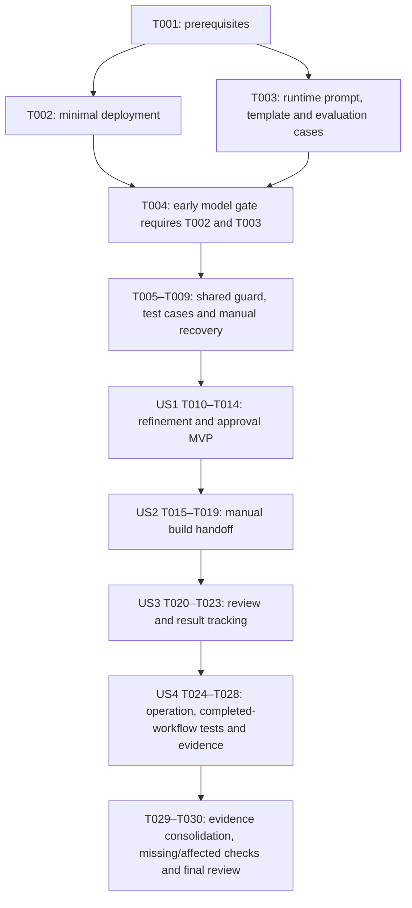

# Tasks: Basic A — Manual Software Factory

**Input**: [plan.md](plan.md), [spec.md](spec.md), [research.md](research.md),
[data-model.md](data-model.md), [contracts/](contracts/task-lifecycle.md), [quickstart.md](quickstart.md).
**Created**: 2026-11-23. **Governance alignment**: 2026-11-26 (constitution v2.0.0; brief v2, 2026-11-25).
**Branch**: `001-basic-a-factory`. Existing task work and planning amendments are preserved.
**Tests**: The owner explicitly requests shared-flag success/no-work release and unexpected-failure
retention tests, plus early model evaluation (local trials retained; owner adopted Gemini). These tasks plan those checks; no result is asserted.
**Organization**: Shared prerequisites followed by the four spec user stories in priority order.
All paths below are repository-relative. Check a task only after completing it and recording checks.

## Format and scope

`- [ ] TNNN [P?] [USn?] Description with exact paths`. `[P]` marks independent file work only;
it does not authorize parallel production mutations or concurrent factory builds.
SpecKit templates create development artifacts. Runtime refinement uses only
`factory/templates/task.md` and `factory/prompts/refinement.md`, versioned with the refine JSON.
No runtime SpecKit resolver/full pipeline is introduced.

This is Basic A: three workflows, owner-selected Gemini refinement, manual Codex on Fedora, Ubuntu/Compose,
one Building slot, explicit approval, review and manual operational JSON import. No runner, Redis, automatic
resume/repair, question-to-issue automation or advanced extension work. Manual recovery and the
single fail-stop interlock remain intentional. The existing spec/plan are amended for governance
alignment only; no feature regeneration or new Basic B/advanced implementation is authorized.

### Import and test policy for remaining work

Automated import, update and execution are permitted only in a designated isolated dev/test n8n
instance using test data, scoped test credentials and designated external test resources. No
operational workflow replacement/activation or ordinary factory-task processing is permitted in
this testing. T033 verifies these boundaries before future automated imports or native tests.
Operational adoption requires owner review of versioned JSON in its PR and owner manual import
of the matching reviewed revision, renewed for subsequent changes, before or after merge.
Manual import does not require manual execution of every test. Evidence identifies tested
revision/hash, imported revision, environment, test-copy deltas and actual outcomes.

Completed task descriptions and dated checkpoints below retain the historical process and
observations; old manual test-import handoffs describe that process, not a continuing blanket
prohibition. Checkboxes and valid evidence are preserved. Only missing/change-affected checks
are required. Approval/resumption is accepted owner policy without instructor confirmation;
Basic A retains manual launch, explicit owner rework and owner-controlled recovery.

## Phase 1: Setup and early model decision

**Purpose**: Verify the cheapest viable deployment and refinement path before building workflows.

- [X] T001 Verify existing repository/labels and development prerequisites, record confirmed `Project owner.repository`, `Project owner.owner login` and `Project owner.stable owner ID` from [data-model.md — Project owner](data-model.md#project-owner) in `docs/operations.md`; establish `factory/`, `evidence/` and separate `product/` layout without choosing/implementing a product or recreating repository labels; extend `.gitignore` only for generated/private runtime artifacts.
- [X] T002 Create minimal pinned n8n/Ollama deployment in `factory/compose.yaml` and nonsecret `factory/.env.example`; persist separate volumes, publish n8n on server loopback only, keep Ollama private with GitHub egress, serialize production executions and document existing SSH access in `docs/operations.md`; validate Compose configuration without exposing secrets.
- [X] T003 [P] Write draft versioned runtime template and prompt in `factory/templates/task.md` and `factory/prompts/refinement.md` using `contracts/refinement.md`; map rendered `Refinement comment.goal`, `Refinement comment.constraints`, `Refinement comment.acceptance criteria` and `Refinement comment.questions` to [data-model.md — Refinement comment](data-model.md#refinement-comment); create five bounded evaluation inputs in `factory/tests/fixtures/refinement-cases.json` for clarity, ambiguity, revision, conflicting constraints and injected instructions. Record the reasons for the runtime template fields and refinement-prompt instructions in `docs/refinement-design.md`, distinguishing brief/constitution requirements from design choices; T014 supplies the validated output example.
- [X] T004 Close out early model evaluation using T002/T003 and `contracts/refinement.md`: retain failed Ubuntu local trials and incomplete memory observations in `evidence/ollama-evaluation.md`; record owner-selected Gemini 3.5 Flash-Lite (2026-11-24), versioned quality results and successful actual Ubuntu container-to-API smoke check in `evidence/gemini-evaluation.md`. Keep unrun checks visible; assess prompt-v3 effects on revision/ambiguity/conflict and run only needed checks, reusing unaffected results. Do not claim cold/warm loading or remote peak RAM for hosted inference. Confirm owner review and editor access; saved n8n credential/HTTP-node verification belongs to T012/T014. No paid fallback or hardware purchase.

**Owner decision 2026-11-24**: Gemini 3.5 Flash-Lite adopted on the confirmed free tier after
local failures and hosted/server checks. The explicit alternative-model checkpoint is satisfied,
so foundation implementation may proceed. T004 is complete after owner acceptance; actual
credential/node and any subsequent change-affected checks gate refinement activation.
**Closeout update 2026-11-24**: Owner confirmed editor/owner-account access; the three affected
v3 cases passed technical/assistant semantic checks. The owner reviewed and accepted the outputs
("they look good to me"); T004 is complete. See `evidence/gemini-v3-review.md`. Later credential/node
checks remain T012/T014.

**Checkpoint**: T004 passes or the owner explicitly chooses a revised model plan. A missing server
or failed trial is a visible blocker, not a completed task. Drafting unrelated documentation may
continue; full workflow implementation and activation must not bypass this gate.

## Phase 2: Foundational execution guard and manual recovery

**Purpose**: One shared execution interlock; no per-task ledger or automatic recovery framework.

- [X] T005 Document and have the owner provision a test row for `factory_control.key`, `factory_control.busy`, `factory_control.execution_id`, `factory_control.issue_number` and `factory_control.started_at` exactly as defined in [data-model.md — factory_control](data-model.md#factory_control--one-row-not-a-task-ledger), including missing/duplicate rows and nullable context, in `docs/operations.md`; no SQL against n8n internals or automatic timeout reset.
- [X] T006 Specify runnable guard-path tests with setup, injected fault points, assertions and cleanup in `factory/tests/guard-scenarios.md` for **each** refine/reserve/track workflow: acknowledged success releases; acquired-but-no-work releases; pre-held flag/context remains unchanged; unexpected exception before/after side effect retains busy; failed acquisition prevents remote work; failed/uncertain release is not assumed idle; later polls skip held failures. In the same small test guide, define fixture inputs/expected results for `contracts/task-lifecycle.md`, `contracts/refinement.md` and `contracts/manual-handoff.md` before their story implementations; record unimplemented behavior as not-yet-passing, never as successful validation.
- [X] T007 Implement the same bounded entry/acquire/verify and success/no-work-release wiring in inactive skeletons `factory/workflows/refine.json`, `factory/workflows/reserve.json` and `factory/workflows/track.json` per `contracts/task-lifecycle.md`, implementing `factory_control.key`, `factory_control.busy`, `factory_control.execution_id`, `factory_control.issue_number` and `factory_control.started_at` from [data-model.md — factory_control](data-model.md#factory_control--one-row-not-a-task-ledger); normal acknowledged-success and acquired-but-no-work exits must release the flag. Unexpected failures, error outputs and aborted executions must retain it. An execution finding an existing hold must preserve it. No unconditional finally release, continue-on-error shortcut or automatic flag expiry is allowed.
- [X] T008 Have the owner manually import reviewed skeletons into an isolated n8n instance, then execute only T006’s skeleton guard cases against the actual workflow paths, including an unanticipated exception and restart with busy set; full refinement, handoff and result-tracking contract cases remain pending until T014, T019 and T023, and T026 completes guard coverage on the finished workflows; record observed guard rows and failed/skipped executions in `evidence/guard-validation.md`; repair wiring until success/no-work leave idle and unexpected failures remain held. Do not substitute helper-only tests for workflow wiring tests.

**T005–T008 closeout, 2026-11-24**: Owner provisioned the isolated row and manually
imported/mapped the three inactive skeletons. T006's guard/contract fixture guide and T007's
source skeletons are complete. Owner manually imported the reviewed test-only native bridge;
assistant-operated validation then passed 57 primary guard checks, 73 held-skip checks and six
original-schedule checks, with native node traces and deliberate in-flight restart failures
preserved. Original owner-run exception checks are retained; the miswired reserve test attempt
is recorded separately, not counted as a post-effect pass. T008's primary skeleton guard
validation is complete. Supplemental payload/receipt variants and direct UI cancellation are
explicitly unrun; full story/finished-workflow coverage remains T014/T019/T023/T026.
See `evidence/guard-validation.md` and `evidence/guard-bridge-results.json`. All 11 isolated
workflows, including the bridge, are unpublished; the test row is deliberately held and effect
rows retained. No production change, issue/model call, automatic import or T009+ work occurred.
The Phase 2 foundation checkpoint still requires T009; do not start user stories from this
partial-phase closeout.

- [X] T009 Write pause/drain/inspect/record/repair/reset/resume instructions and credential/export boundaries in `docs/operations.md` and `docs/permissions.md`; include GitHub-outage visibility fallback, manual agent checks, no blind unknown-write retry, role-needed token permissions and manual reviewed JSON import. Preserve owner initial/scope approval and review/merge authority.

**T009 closeout, 2026-11-24**: Added owner-controlled recovery, outage incident record,
uncertain-write/release reconciliation, agent/reservation checks and reviewed import/revision
verification in `docs/operations.md`; added component/token, credential/data-transfer and public
export boundaries in `docs/permissions.md`. The former instructor-confirmation follow-up is superseded by accepted owner policy (2026-11-26).
Validation: manual comparison with constitution/plan/contracts and T008 shutdown evidence;
16 local Markdown links/anchors and both documents' code fences checked; `git diff --check`
passed. GitHub/n8n technical references checked against official documentation. Documentation
only: no guard/model checks repeated, recovery exercise, workflow change, import or runtime
mutation. T010+ remains unchecked and production activation remains gated on later validation.

**Checkpoint**: Minimal model trial and guard behavior validated; full story workflows can now
be completed. All production-mutating manual tests require paused/drained schedules or isolation.

## Phase 3: User Story 1 — Refine and explicitly approve a task (P1)

**Goal**: Owner-authored ideas become checkable refinements and require explicit owner approval.
**Independent test**: Submit an idea, revise it through comments, approve the latest refinement;
no coding agent is needed to demonstrate this story.

- [X] T010 [US1] Complete owner-only paginated discovery, PR-object exclusion and source-state validation in `factory/workflows/refine.json`, citing `Task issue.author ID`, `Task issue.current labels`, `Task issue.open/closed status` and preserved unrelated labels in [data-model.md — Task issue](data-model.md#task-issue); ordinary no-work/non-owner/already-processed paths release an acquired guard.
- [X] T011 [US1] Implement canonical source capture, marker filtering and repeat suppression in `factory/workflows/refine.json` using `Refinement comment.source body SHA-256`, `Refinement comment.captured source comment IDs`, `Refinement comment.last included unmarked owner comment ID`, `Refinement comment.prompt version`, `Refinement comment.source key` and its marker definition in [data-model.md — Refinement comment](data-model.md#refinement-comment); retain prior revisions and detect captured edits/deletions rather than including every later session/rework comment.
- [X] T012 [US1] Finalize `factory/templates/task.md` and `factory/prompts/refinement.md` from the early trial, assessing material changes and running only missing/change-affected checks, then wire their reviewed versions into `factory/workflows/refine.json` with bounded Gemini generateContent request using a saved header-auth credential, strict final-output validation and fixed Markdown rendering per `contracts/refinement.md`; verify the actual credential/HTTP node after owner manual import before activation. Make Ollama startup optional in Compose without deleting the existing cache/data or changing the server without a reviewed rollout; do not load `.specify/templates/` or give the model state-changing tools.
- [X] T013 [US1] Implement `Ideas`/owner Ready-stage discussion -> `Refining` -> validated marked comment -> `Ready for approval` in `factory/workflows/refine.json` per [data-model.md — State transitions](data-model.md#state-transitions); failed/stranded Refining and unknown writes hold for manual recovery, never infer approval or auto-resume.
- [X] T014 [US1] Before live exercises, have the owner manually import the reviewed `factory/workflows/refine.json` with the reviewed runtime prompt/template versions; record the reviewed commit and imported revision in `evidence/refinement-validation.md`, then run refinement/revision/unchanged-poll and approval exercises in `specs/001-basic-a-factory/quickstart.md`, extending `factory/tests/fixtures/refinement-cases.json` only for necessary edge inputs, and record outcomes/example output in `evidence/refinement-validation.md`; verify no non-owner processing or factory-comment loop, no duplicate unchanged output, no initial AI approval, and no unexpected-failure release.

**US1 implementation update, 2026-11-24**: T010/T011/T013 are implemented in inactive
`factory/workflows/refine.json`; 21 local exported-code/graph scenario groups pass. Runtime
prompt v3/template v1/schema are unchanged, and all five generated fixture request payloads
match the evaluation layout. T012's source wiring and optional Ollama profile are prepared,
but T012 remains unchecked until the saved credential/actual n8n HTTP node passes after owner
manual import. T014 remains unchecked: reviewed commit/imported revision and live issue,
revision, unchanged-poll, failure-retention and owner approval evidence are not yet recorded.
See `evidence/refinement-validation.md` for actual local checks, limits and the concrete import
handoff; `docs/refinement-example.md` renders accepted evaluation content offline, not a live
workflow output. No server rollout, import, activation, model call or GitHub mutation was
performed. US2+ tasks remain out of scope and unchecked.

**T012 integration closeout, 2026-11-25**: Native execution 753 on the owner-imported
reviewed token-counting workflow passed: countTokens and generateContent HTTP 200, 576 input /
106 output tokens, one generation, validated marked comment 7160240711 on issue #1, Ready for
approval and verified guard release. Prompt v3/template v1/schema remain unchanged; local tests,
native VM checks, prior quality evidence and optional Ollama source configuration are retained.
See `evidence/refinement-validation.md` for source/budget/output evidence and the preceding
failures/recovery. T012 is complete. T014 remains in progress for unchanged-poll, owner revision,
approval and remaining acceptance evidence; no production activation or completed build is claimed.

**Checkpoint**: Smallest useful MVP is refinement/revision/approval after Phases 1–2. This is not
claiming that the complete Basic A build/review loop or final course submission is delivered.

**US1 token-budget amendment, 2026-11-25**: Owner approved actual Gemini countTokens preflight
after execution 751 stopped on the overly conservative byte screen. Count the unchanged full
generation request, reserve fixed schema allowance plus 768 output / 256 overhead within the
same 4096-token application budget, and retain a separate 32 KiB transport cap. No truncation,
automatic retry, paid/model fallback or approval behavior is added. The same saved Gemini
credential serves both HTTP nodes; exact-output reuse skips both calls. 27 local scenario groups
and 223 native VM expression checks pass. A standalone count-only API check on the original
issue returned 576 tokens (2056 reserved total); it is not a native saved-credential/workflow
pass. T012/T014 remain unchecked pending owner import, recovery and successful live validation.
See `evidence/refinement-validation.md` for failure history, owner authorization and actual limits.

**US1 retry amendment, 2026-11-25**: After execution 756 returned another 503, owner authorized
selective generation retries: at most three attempts, 10/30-second in-process waits, explicit
503 UNAVAILABLE only, same counted payload and guard/source rechecks before each attempt.
Contracts/notes/tests updated. Other failures/exhaustion/interruption retain busy. Local 35
scenario groups and 291 native synthetic parameter/Wait checks pass. Actual delayed workflow
retry/cancellation/restart checks remain pending owner manual import under T014. T012 remains
complete from 753; T014 stays unchecked. Earlier no-retry statements describe prior revisions.

**US1 execution 757, 2026-11-25**: Owner imported/saved the retry revision and deliberately
recovered the 756 hold. Fresh execution succeeded on attempt 1 (HTTP 200), input count 663,
reserved total 2143/4096, comment 7161366810 and busy=false. Read-only public review confirms
the privacy acceptance criterion and previous constraints, Ready for approval, no Approved label.
Owner approval and native live retry/delay/interruption coverage remain pending; T014 stays open.

**US1 owner approval, 2026-11-25**: Owner accepted refinement 7161366810 and replaced Ready
with Approved. Public label event 37246567614 at 11:45:26Z confirms actor 202449424; issue remains
open with six comments. Explicit approval passes. Post-approval refine poll and other native
acceptance cases remain pending; T014 stays unchecked. US2 reservation/build is out of scope.

**US1 post-approval poll, 2026-11-25**: Execution 758 returned released/no_work, busy=false,
issue_number=null. Read-only public verification confirms issue #1 remains Approved, open,
with six comments and no Building claim. The post-approval poll passes. T014 remains unchecked
for outstanding native edge cases, including 503/backoff/exhaustion/interruption; US2 remains
out of scope. No production activation or completed build/PR is claimed.

**US1 remaining-test preparation, 2026-11-25**: Owner requested assisted execution. Native
snapshots now verify imported 757/758 Code/connections, eight table and 23 HTTP/credential
mappings; 754/758 traces confirm no count/inference calls. Actual core 10/30-second waits and
AbortSignal cancellation pass; full graph cancellation is not implied. Prepared credential-free
native fault bridge and 43-case HTTP simulator pass fixture packaging plus 335 installed VM/
Wait checks. The loopback-only synthetic server is ready inside factory-guard-test. Zero full
bridge cases have run at this historical checkpoint; the former owner test-import gate is
superseded by the 2026-11-26 isolated-testing policy above.
T014 stays unchecked. See `factory/tests/refinement-bridge.md` and the validation evidence.

**T014 reconciled closeout, 2026-11-25**: Required real refinement/revision/unchanged/explicit
owner approval exercises pass; 41 native synthetic cases, restart hold and full UI cancellation
are verified within the recorded evidence limits. Acceptance matrix now cites actual execution
IDs, retains pagination failure 1132 and fixed success 1140, and distinguishes real API runs
from synthetic HTTP effects. T010–T014 are complete. Historical pending statements above refer
to earlier checkpoints. No US2+ task is changed, no production activation/merge/build is claimed.
Final test hold is execution 1218 / issue 101; bridge unpublished and fixture stopped. See the
closeout/provenance/limits in `evidence/refinement-validation.md`. PR #2 awaits owner review.

## Phase 4: User Story 2 — Build manually with traceable decisions (P1)

**Goal**: Reserve one approved task; owner launches Codex locally and records material decisions.
**Independent test**: Supply an approved issue fixture/real refinement, reserve it while the
laptop is idle, verify a second waits, then manually complete a small build and session question.

- [X] T015 [US2] Implement current owner approval validation in `factory/workflows/reserve.json` per [data-model.md — Approval event](data-model.md#approval-event): cite `Approval event.label event ID`, `Approval event.actor ID`, `Approval event.timestamp` and current-refinement/source constraints, including `Refinement comment.comment ID`, `Refinement comment.updated times` in [data-model.md — Refinement comment](data-model.md#refinement-comment); missing/edited history holds rather than granting approval, and n8n never adds Approved.
- [X] T016 [US2] Implement single-slot discovery/selection and `Approved` -> `Building` in `factory/workflows/reserve.json`, citing `Build reservation and handoff comment.Reservation` and its label semantics in [data-model.md — Build reservation and handoff comment](data-model.md#build-reservation-and-handoff-comment); all Building issues block another claim regardless of author, lowest eligible issue number wins, and occupied-slot/no-candidate paths release only the short-lived acquired guard.
- [X] T017 [US2] Post deterministic handoff evidence in `factory/workflows/reserve.json`, citing `Build reservation and handoff comment.issue number`, `Build reservation and handoff comment.approval event ID`, `Build reservation and handoff comment.refinement comment ID/URL and content digest`, `Build reservation and handoff comment.branch`, `Build reservation and handoff comment.baseline existing PR numbers/head SHAs and states`, and `Build reservation and handoff comment.timestamp` in [data-model.md](data-model.md#build-reservation-and-handoff-comment); uncertain label/comment outcomes retain busy for manual repair.
- [X] T018 [P] [US2] Add Fedora manual issue-branch/worktree launch, approved-input check, in-session questions and issue-summary instructions to `docs/manual-coding.md`, citing `Decision record.question/answer and resulting choice`, `Decision record.whether scope changed`, `Decision record.explicit renewed approval reference` and its scope/secret rules in [data-model.md — Decision record](data-model.md#decision-record) and `contracts/manual-handoff.md`; expanded scope stops for fresh explicit approval, with no automatic agent launcher.
- [X] T019 [US2] Before live exercises, have the owner manually import the reviewed `factory/workflows/reserve.json` and verify the active refine workflow still matches its reviewed revision; record reviewed commits/imported revisions in `evidence/manual-build-validation.md`, then execute delayed-launch, second-approved-task, repeated-poll/restart and interrupted-reservation scenarios from `specs/001-basic-a-factory/quickstart.md`; record them and a real manually launched question/answer summary in `evidence/manual-build-validation.md`; prove successful reservation releases busy while Building persists, and unexpected failures block later schedules without releasing that slot.

**US2 closeout, 2026-11-25**: T015–T019 are complete. Owner reviewed/imported reserve
source ec5a2de and the existing reviewed US1 pagination fix; imported revision IDs and source
fingerprints are recorded in `evidence/manual-build-validation.md`. Real native 1275 reserved
#1 and released busy while Building persisted; 1276/1277/1279 pass repeated polling, idle
restart and a second explicitly approved #4 waiting. Owner-launched issue-1 produced PR #5
and real question/answer/scope summary 7170400632, with actual checks/unrun criteria visible.

Owner-imported/published isolated test bridge passed 13 native cases plus seven held skips,
including invalid approval/source, all Building variants, unexpected before/after effects,
partial labels and lost POST response. Controlled in-flight restart 1369 retained partial
synthetic reservation and busy; held 1372 and native scheduled 1376/1378 preserved the row
without HTTP/release. Operator coordination/readiness issues and recovered-event metadata
limits are retained, not hidden as successful runs. No production runtime fix was needed.

Owner unpublished the bridge. Read-only export confirms all 20 isolated workflows inactive,
its test webhook 404, and the exact busy=true/1369/issue101 row and fixture effects preserved.
Source/package/VM/native evidence is in `evidence/reservation-native-results.json` and
`evidence/reservation-fault-results.json`. Source guard/prompt/template and US1 evidence are
reused unchanged; US3/track and production activation remain out of scope. PR #5 is open for
owner review; this closeout does not claim a merged result, complete Basic A loop or five runs.

**Checkpoint**: Manual execution works; no runner or automated question/restart behavior exists.

## Phase 5: User Story 3 — Review and track the result (P2)

**Goal**: Associate current results, preserve owner review and handle merge/rejection/rework.
**Independent test**: Supply an approved handoff and linked PR, exercise QA/rework/merge and issue
closure, including a closed-unmerged PR with the issue still open.

- [ ] T020 [US3] Implement paginated result matching in `factory/workflows/track.json`, citing `Result pull request.head repository/branch/SHA`, `Result pull request.base branch`, `Result pull request.body issue link`, `Result pull request.state`, `Result pull request.merged status/time` and `Result pull request.activity times` in [data-model.md — Result pull request](data-model.md#result-pull-request); require an unambiguous current result and compare the handoff PR baseline/new approval so stale PRs cannot overwrite rework.
- [ ] T021 [US3] Implement result markers and `Your QA`/`Done` tracking in `factory/workflows/track.json`, citing `Result pull request.current approval event ID`, `Result pull request.PR number`, `Result pull request.head SHA` and result-marker constraints in [data-model.md](data-model.md#result-pull-request), plus [State transitions](data-model.md#state-transitions); merged current result/closed issue completes, while unmerged closure with open issue stays QA; unchanged/no-result paths release acquired busy and unexpected failures retain it.
- [ ] T022 [P] [US3] Document issue-linked PR summary/actual checks, owner review, explicit rework approval, isolated automated testing and manual operational workflow JSON import in `docs/review.md` per `contracts/manual-handoff.md`; distinguish universal review gates from additional factory-task approval/linkage gates and show failed/unrun acceptance criteria honestly.
- [ ] T023 [US3] After T033, import `factory/workflows/track.json` into designated isolated test n8n (automation permitted); verify imported source and test-only mappings, while operational workflows remain untouched. Record tested commits/environment/imported revisions in `evidence/review-validation.md`, then exercise open-result QA, merge, issue close, closed-unmerged/open-issue, fresh rework/new head and ambiguous stale PR cases, recording results in `evidence/review-validation.md`; verify ordinary session summaries/in-scope rework comments do not invalidate captured source, repeated polls do not duplicate QA markers, and no autonomous merge or operational import occurs. Operational adoption separately requires owner PR review and manual import of the matching reviewed JSON revision, before or after merge.

**Checkpoint**: The complete normal Basic A loop is available, subject to cross-workflow validation.

## Phase 6: User Story 4 — Operate and demonstrate the manual factory (P2)

**Goal**: Reproducible server/laptop operation, visible failures, manual recovery and real-run evidence.
**Independent test**: Follow only the runbooks, inspect a known failed/held task and safely recover;
trace a real task's input, decisions, PR and review entirely from sanitized repository evidence.

- [ ] T024 [US4] Complete deployment/operations instructions in `docs/operations.md` for private SSH editor login, pinned model/images, one production instance, volume/encryption-key backup and restore, private execution retention and manual import/revision verification; preserve one-row guard and no automatic recovery/expiry tradeoff.
- [ ] T025 [P] [US4] Create `docs/architecture.md` from the reviewed Basic A design, explicitly separating `.specify/templates/` development artifacts from runtime `factory/templates/task.md` and `factory/prompts/refinement.md`, and showing server n8n, outbound Gemini refinement, Fedora manual coding and GitHub interface; distinguish retained optional Ollama trial artifacts from runtime dependencies.
- [ ] T026 [US4] Complete the `factory/tests/guard-scenarios.md` matrix against **all three completed workflows** in isolation; verify source/imported revisions and isolated environment under T033, reuse applicable current-version story evidence and execute missing or change-affected cases, including success, every no-work early return, already-busy entry, unexpected exception before/after side effects, failed final release, crash/restart and missing/unconfirmed acquisition; record actual rows, failed/skipped executions and later-poll behavior in `evidence/guard-validation.md`; do not accept skeleton/helper-only results or unconditional cleanup that masks failures.
- [ ] T027 [US4] Execute pause/drain/inspect/repair/reset/resume and backup/restore exercises, including GitHub outage, partial label transition and unknown comment POST, in an isolated deployment; record operator steps, marker inspection, retained Building reservations and sanitized failures in `evidence/recovery-validation.md`; ambiguous outcomes remain held rather than retried automatically.
- [ ] T028 [US4] Assemble `evidence/index.md` linking the real task issue/PR, refinement, session decision, owner review and actual checks from the validation records; explicitly distinguish fixtures from real runs, count only genuine issue/PR-linked tasks and retain the final-project minimum of five runs as outstanding until actually met.

**Checkpoint**: Basic A has real-run evidence and documented human intervention, not merely a diagram.

## Phase 7: Polish and cross-cutting review

- [ ] T029 Summarize existing acceptance evidence against `specs/001-basic-a-factory/quickstart.md` in `evidence/acceptance.md`, linking T004/T014/T019/T023/T026/T027/T028 results and their tested revisions with passed/failed/unrun status; use T026 as the completed-workflow guard evidence, not a second guard test pass. Run only checks missing from the evidence or affected by subsequent changes (including any missing or change-affected secret/export/permission checks), recording why each additional check is needed; changed test JSON may be imported automatically after T033; any operational adoption requires owner PR review and manual import of the matching reviewed revision. Do not blanket-rerun the acceptance matrix or checks already valid for unchanged artifacts.
- [ ] T030 Review all Basic A artifacts on an appropriate PR/branch, update `docs/operations.md` with reviewed active workflow versions and owner-manual import evidence, and accepted initial-approval/unchanged-scope-resumption policy; no auto-merge, automatic operational workflow adoption, Basic B implementation or advanced work is authorized by this checklist.

## Dependencies and execution order

- **Setup**: After T001, T002 (deployment) and T003 (prompt/template/evaluation cases) are
  independent and may proceed in parallel. **T004 early model gate requires both T002 and
  T003**. Drafting T003 does not wait for deployment readiness; do not implement full workflows
  to discover only later that local inference is unsuitable.
- **Foundation**: T005 -> T006 -> T007 -> T008 -> T009. No user-story implementation before the
  early model and shared-guard checks pass. Reviewing docs may proceed while a hardware gate waits.
- **US1**: T010 -> T011 -> T012 -> T013 -> T014.
- **US2**: Follows US1 for end-to-end use; T015 -> T016 -> T017 -> T019. T018 may run alongside
  T015–T017 because it edits a separate document and reads finalized contracts only.
- **US3**: Requires an approved handoff; T020 -> T021 -> T023. T022 can proceed alongside
  T020–T021. Historical fixtures can be prepared without claiming earlier stories complete.
- **US4**: T024 -> T026 -> T027 -> T028; T025 can proceed alongside T024. T026 runs after the
  completed workflows, not only skeletons. Completed T014/T019 imports remain historical evidence.
  T033 precedes future automated imports/native isolated checks, including T023/T026/T027 and any
  change-affected T029 checks. It need not block offline T020–T022 work. Owner manual operational
  import remains required for adoption; T030 cannot substitute for that gate.
  T029 consolidates the resulting evidence and runs only missing/change-affected checks; T030
  follows for final review and recording, not deferred first imports.
- This individual project normally proceeds serially. No parallel production mutations or
  multiple manual Coding builds are enabled by `[P]` markers.

### Dependency graph

### Field-constraint coverage review

Canonical fields are cited in implementing tasks, rather than copied into a new schema:
owner identity T001; issue eligibility/state T010; refinement output T003/T012 and source/marker
constraints T011; approval event/current refinement T015; reservation and handoff T016/T017;
session decision/secret rules T018; current PR/result association T020/T021; shared row types,
nullable context and singleton/fail-stop rules T005/T007. State transitions resolve to the
canonical table through T013/T021. Lifecycle, refinement and manual-handoff contract fixtures
are specified before implementation in T006 and exercised by T014/T019/T023/T026.

## Parallel examples per user story

- **Setup**: T003 can run alongside T002 after T001; T004 waits for both.

- **US1**: No parallel tasks within `refine.json`; keep source/digest/model/state changes ordered.
- **US2**: T018 (`docs/manual-coding.md`) can run alongside T015 (`reserve.json`).
- **US3**: T022 (`docs/review.md`) can run alongside T020 (`track.json`).
- **US4**: T025 (`docs/architecture.md`) can run alongside T024 (`docs/operations.md`).

## Implementation strategy

Start with the server preflight; prepare deployment and draft refinement inputs independently,
then join them for the bounded model evaluation before the single shared guard. Deliver
US1 as a useful refinement MVP; add manual handoff and reviewed results, then operate and gather
real evidence. Tests requested here must cover actual workflow completion/error routing, not
just duplicate control logic in Python. Manual fixture tests and isolated fault injection are
acceptable; use the smallest practical harness and standard-library checks where useful.

Checkboxes record actual completion. Owner-only initial/scope approvals, manual operational
JSON imports and conservative manual recovery remain acceptance boundaries throughout. If stronger exactly-once behavior or autonomous
recovery becomes necessary, surface that requirement and revise the plan instead of silently
weakening FR-016 or implementing a new orchestration platform.

## Isolated-test boundary verification (before future automated testing)

- [ ] T033 [US4] Verify the existing isolated development/test n8n environment before any future automated import/update/native execution (FR-012/013, SC-003/006). Record instance identity/version, separate volume/control tables, test credential scopes, designated fixture or external test resources, and all HTTP destinations/mappings in `docs/operations.md` and `evidence/acceptance.md`. Verify it cannot target operational workflows or ordinary factory tasks; stop on unknown boundaries. Reuse existing `factory-guard-test` setup/evidence where valid rather than create another deployment or rerun completed suites. Record tested source/imported revisions and environment for subsequent tests; keep owner PR review/manual matching-revision import as the separate operational adoption gate. This task does not authorize operational deployment or a new test framework.

## Phase 8: Convergence

US1-only assessment (T010–T014), 2026-11-25. Existing completion markers and historical
evidence are retained. This finding concerns scheduled-entry validation, not US2–US4 work.

- [X] T031 [US1] Close the HIGH scheduled-entry validation gap per US1/AC1–2, SC-001 and T014 (partial): after owner review/manual import, exercise the current refinement Schedule Trigger in isolation at its reviewed interval for eligible idea processing, owner-requested revision and an unchanged subsequent poll; verify Refining -> marked output -> Ready, one revision per new captured input, no duplicate output and acknowledged guard release. Reuse existing real-task/provider and unaffected guard/fault evidence; distinguish synthetic HTTP inputs from real GitHub/API observations and explicitly map scheduled-path evidence to the real US1 task exercises. Record source/import fingerprints, native schedule-trigger execution IDs, issue/comment or fixture references, guard observations and any failure/manual intervention in `evidence/refinement-validation.md`; update the acceptance matrix and PR summary accordingly. Existing skeleton schedules and webhook/manual-entry runs alone do not establish this acceptance condition. Keep production untouched, enable only one isolated test schedule at a time, and unpublish/drain it afterward; inspect the retained 1218 hold before any deliberate reset.

**T031 implementation checkpoint, 2026-11-25**: Prepared the current-source scheduled test
copy and persistent synthetic issue observer; all 31 source Code bodies, original Schedule
Trigger/60-second interval and guard path are preserved. Fixture persistence/revision preflight
and packaging/syntax checks pass. The loopback-only fixture service is ready, but no scheduled
case is claimed: owner manual import of the reviewed new test copy is still required. Retained
1218 hold is unchanged. T031 remains unchecked pending native scheduled evidence and PR update.

**T031 complete, 2026-11-25**: Owner manually imported scheduled copy OmzjTQGq75oRBNfR,
saved version a613366f-ab78-4fa6-9f97-f74f96d222ac. Native trigger-mode executions 1232/1234/1263
passed idea/revision/unchanged polling at the exact 60-second source interval with acknowledged
idle release. All Code/connection fingerprints match. Ten extra unchanged ticks 1265–1274 are
retained, each with zero model calls/posts. Evidence is in `evidence/refinement-scheduled-results.json`
and the reconciled matrix, explicitly mapped to real issue #1 exercises. Known 1218 hold was
inspected and deliberately reset for this independent isolated test; final observed row is idle
at 1274. Schedule unpublished, route 404, fixture stopped; production untouched. No other task
status changed. Owner PR review/merge and any production import remain separate.

## Phase 9: Convergence

US2-only assessment (T015–T019), 2026-11-25. Existing completion markers and real/native
observations are retained; this finding concerns the successful scheduled reservation path.

- [X] T032 [US2] Close the HIGH scheduled-reservation validation gap per FR-001, US2/AC1, US2/AC5 and T019 (partial): after owner review/manual import, exercise the current reserve Schedule Trigger in isolation at its reviewed 60-second interval with an idle guard and eligible approved synthetic tasks; verify the lowest eligible task transitions Approved -> Building before any manual agent launch, posts exactly one matching handoff and releases busy while Building persists. Observe a subsequent native scheduled poll with another approved task waiting; require no second reservation or duplicate handoff and acknowledged no-work release. Reuse existing real issue #1/manual build/decision/PR #5 and unaffected native approval/fault/restart evidence; explicitly distinguish synthetic HTTP effects from real GitHub observations and map the scheduled-path results to the real manual-entry exercises. Record reviewed/imported fingerprints, mode=trigger execution IDs, reached nodes, before/after guard and fixture state, failures and owner interventions in `evidence/manual-build-validation.md` and linked sanitized results. Manual/webhook runs, local scheduled-entry stand-ins and scheduled held skips alone do not establish this acceptance condition. Inspect retained busy=1369/issue101 before any owner-directed reset; preserve its evidence. Keep production and real Building/Approved issues untouched, enable only one isolated test schedule at a time, and have the owner unpublish/drain it afterward with final state verification; no automatic agent launch or US3 work.

**T032 preparation checkpoint, 2026-11-25**: Prepared a separate credential-free scheduled
reservation copy, persistent synthetic session 32001 and read-only tick observer. All 20
source Code bodies/connections and exact 60-second schedule are preserved by packaging
assertions. Build/consistency, Python syntax and whitespace checks pass. No native scheduled
reservation is claimed. Owner reviewed manual import is required before execution; retained
1369 hold is unchanged by this checkpoint. T032 remains unchecked. See
`factory/tests/reservation-schedule.md` and `evidence/manual-build-validation.md`.

**T032 complete, 2026-11-25**: Owner imported/published the isolated schedule copy
RByomITdtfRHZ74Z, version 06387d3e-9ca6-40ec-bf43-3b990ee8ebad. Native trigger-mode
1411 reserved synthetic 101 with one exact handoff and busy release; 1439 left 102 waiting
with no writes/duplicate. All 20 source Code hashes/connections and exact 60-second schedule
match. Known 1369 hold was inspected and deliberately reset for this independent test;
historical fixture evidence remains unchanged. Owner unpublished; all 21 workflows inactive,
state route 404, final row idle at 1442, one handoff and queued Approved fixture preserved.
Disposable fixture process stopped. See evidence/reservation-scheduled-results.json and
manual-build-validation.md; synthetic scheduled effects supplement real #1/PR #5 evidence.
No production runtime change, merge, agent auto-launch or US3 work is claimed.
