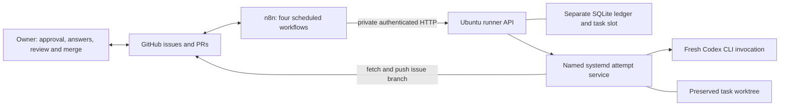

# Implementation Plan: Basic B — Automated Coding-Agent Execution

**Branch**: Actual Git branch `main`; SpecKit reports feature identifier `002-basic-b-agent` independently of Git. No branch was created.
**Date**: 2026-11-27 | **Spec**: [spec.md](spec.md)
**Input**: Clarified Basic B specification, five owner answers, project brief v2 and constitution v2.0.0.
**Status**: Phase 0/1 design complete; no implementation, provisioning or adoption performed.

## Summary

Replace Basic A's manual handoff with a small private Python runner on Ubuntu alongside n8n.
Keep four scheduled workflows: refine/answer, reserve/submit, track review and collect runner
results. Use a separate SQLite runner ledger for durable attempt identity, task reservation,
publication intents and reconciliation. Existing n8n Data Table guards serialize short workflow
mutations; they neither store nor expire the build reservation. Run each attempt in a named
systemd user service so API restart does not hide execution or reset its deadline.

The owner selected structured outcomes, marked answers, fresh invocations preserving attributable
work, explicit retry after interrupted execution, and reservation release at stopped/reconciled
Waiting/Stuck/QA. Answered/retried tasks have non-preemptive queue priority. Implementation choices
below implement these policies; they are not additional assignment mandates.

### Architecture



### Existing behavior and change boundaries

[Basic A architecture](../../docs/architecture.md), [plan](../001-basic-a-factory/plan.md),
and [evidence index](../../evidence/index.md) are preserved. Real manual tasks
[issue 1 / PR 5](https://github.com/MBroholm/software-factory/pull/5) and
[issue 9 / PR 10](https://github.com/MBroholm/software-factory/pull/10) establish the prerequisite;
issue 9 demonstrates actual QA/Done with retained failure/recovery. Two real runs do not satisfy
the final five-run minimum. See [acceptance ledger](../../evidence/acceptance.md).

Current reservation-runtime checks any Building label and validates owner-labelled approval;
tracking-runtime binds results to v1 manual handoffs and approval events. Do not merely insert an
HTTP call into these functions. Add a versioned Basic B attempt/authorization adapter, retain
v1 recognition for historical tasks, and distinguish owner initial approval from answer-derived
continuation. Factory comments can use an owner-owned token, so actor identity alone never
proves a label event or marked comment grants initial approval.

## Technical Context

**Language/Version**: Python 3.12+ runner, JSON contracts, existing CommonJS workflow generators;
record exact Python/Git/systemd/Codex versions in implementation evidence. Local inspected CLI is
0.172.0, not proof of Ubuntu installation. Keep n8n 2.48.8 baseline until separately reviewed.

**Primary Dependencies**: Python sqlite3, subprocess and unittest; small pinned HTTP/schema stack
(FastAPI, Uvicorn, jsonschema) with locked versions selected/tested during implementation;
Git, Codex CLI and systemd user services. No Redis, broker or n8n Execute Command node.

**Storage**: Separate private runner SQLite DB on local Ubuntu disk, not n8n's internal SQLite;
transactional singleton reservation, attempts, answer claims and effect journal. Private task
worktrees and bounded logs persist outside the repository and outside n8n volumes.

**Testing**: Python unit/contract and subprocess failure tests with a fake Codex/GitHub adapter;
existing Node generator/native-expression checks; separate runner/user manager and designated
isolated n8n instance (`factory-guard-test`, loopback editor 5679), separate control table and test
credentials/resources. No ordinary issues processed in isolated testing.

**Target Platform**: Ubuntu runner and n8n Docker bridge; Fedora development only. Dedicated
unprivileged runner account with owner-provisioned Codex auth. systemd user manager availability
and linger are explicit implementation preflight, not assumed deployed facts.

**Project Type**: Single-repository, single-owner asynchronous runner plus generated n8n workflows.

**Performance Goals**: Retain 60-second schedules, one result mutation per execution; HTTP calls
bounded to 10 seconds, acceptance targets under 2 seconds in local tests, never wait for coding.
Hard attempt execution budget at most 1800 seconds; include preparation in this conservative
budget. RuntimeMaxSec=1795s plus TimeoutStopSec=5s bounds graceful termination then group kill;
test actual elapsed process-tree lifetime and do not claim real-time guarantees under host stall.

**Constraints**: No automatic guard expiry, replay, force-push, autonomous merge or uncertain-run
replacement. No model fallback. Required model is explicit private owner configuration, captured
in evidence; absent configuration fails preflight. No model selection inferred from refinement.
Agent outcome is reported, not independent code/test verification. Advanced isolation, Flagged,
AI review, memory and metrics are excluded.

**Scale/Scope**: One repository, one reserved factory task, one worker at a time; multiple tasks
may await owner answers/review without holding the execution slot once safely reconciled.

## Constitution Check

Pre-research gates evaluated against the clarified spec; post-design gates rechecked below.

| Gate | Pre-research | Post-design evidence |
| --- | --- | --- |
| I: explicit initial owner approval, scope protection, owner merge | PASS | Separate initial/answer/retry authorizations; no merge endpoint; contracts enforce source hashes |
| I: isolated test versus manual operational import | PASS | Quickstart requires verified separate targets; operational JSON reviewed and manually imported |
| II: issue/branch/PR traceability and fixed task input | PASS | Immutable input snapshot, v2 markers, issue-N branch, actual check provenance |
| III: real Basic A prerequisite, owner-authored issues, single task | PASS | Existing linked real evidence; runner transaction and non-expiring reservation |
| IV: least-needed credentials, public secret exclusion | PASS | Private endpoint, separate roles/account, sanitized publication allowlist |
| V: truthful outcomes and retained failures | PASS | Attempt/effect history; tests and unchecked criteria recorded with revision/environment |
| Stage boundary | PASS | No advanced verification/isolation/AI review requirements introduced |

All design gates pass; runtime checks and credential audits remain implementation acceptance work.
Existing factory/AGENTS.md says Basic B implementation is out of scope for Basic A. Before any
implementation under factory/, update that stage boundary in a reviewed scoped change; retain
its generator notes, VM-expression and isolated-adoption rules. This planning command edits no
factory files and does not override those instructions.

## Project Structure

### Documentation (this feature)

```text
specs/002-basic-b-agent/
  spec.md
  plan.md
  research.md
  data-model.md
  quickstart.md
  contracts/runner.md
  contracts/agent-and-issue.md
  checklists/requirements.md
```

### Source Code (repository root)

Proposed implementation layout, not files created by this phase:

```text
factory/runner/
  pyproject.toml and dependency lock
  factory_runner/  (API, ledger, worker, reconciler, Git/Codex adapters)
  schemas/agent-result.json
  systemd/  (API unit and per-attempt worker template)
  tests/  (contract, fault, process-tree tests)
factory/scripts/
  build-collect.cjs and collection-runtime.cjs
  existing refine/reserve/track generators and runtimes (adapted)
factory/workflows/collect.json
factory/tests/  (Basic B native and scheduled fixtures)
docs/  (affected operations, permissions and Basic B architecture)
evidence/  (new Basic B records; preserve Basic A records)
```

**Structure Decision**: Extend the existing factory directory and generators; do not create a
second application repository or embed agent execution in n8n. Built software stays in its
existing separate folder. Development SpecKit templates remain distinct from runtime prompts.

### Execution and adoption sequence

1. Implement ledger/API/worker contracts and local fault coverage; no external live effects.
2. Adapt workflow generators, v2 authorization/markers and four-workflow interaction; retain
   numbered stage notes and meaningful node notes, plus VM expression checks.
3. Validate in isolated runner/n8n resources with fake agent and designated test issues; then
   run a bounded real Codex smoke task under scoped test credentials.
4. Owner reviews JSON, permission expansion, account/service/network setup and migration record.
   Pause/drain Basic A, reconcile its existing Building tasks manually, and refuse Basic B
   activation while a Basic A manual execution might remain live. Never auto-adopt it as a run.
5. Owner manually imports matching reviewed JSON, verifies mappings and enables schedules after
   preflight. Record all four fingerprints. Separate service provisioning is a later action.
6. Demonstrate a genuine approved Basic B task and owner review. Rollback pauses/drains and stops
   or reconciles workers before reverting reviewed workflow versions; never roll back the ledger
   to forget active attempts. Retain partial work, evidence and credential mappings privately.

## Complexity Tracking

No constitutional exception. A dedicated durable ledger and named worker are necessary for
asynchronous acceptance, restart reconciliation and timeout independent of n8n; Basic A's
single busy flag cannot provide those guarantees. No distributed queue or autonomous repair.
